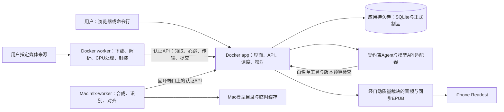
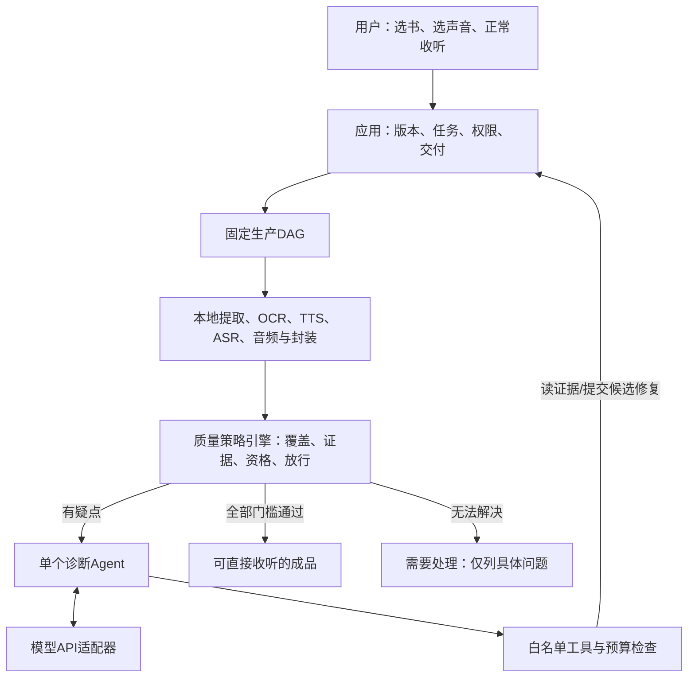
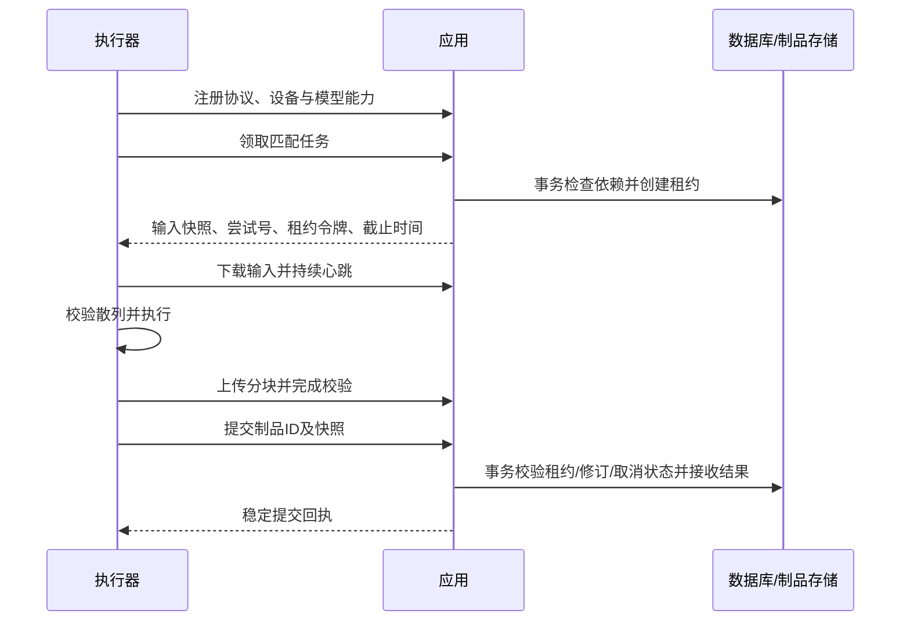

# Folio Voice 系统设计

文档编号：FV-SDD-001　版本：1.6　日期：2026-10-18。本文是唯一产品行为与架构依据；实现及验证状态见[开发任务](开发任务.md)。

初次阅读先看第1–4章，理解目标、用户流程、需求与完整架构；实现时按第5–12章查阅对应模块；第13章记录取舍与风险。相关规则通过链接引用，不以章节先后决定优先级。

- [1. 目标、范围与术语](#scope)
- [2. 用户流程与交互](#experience)
- [3. 需求基线](#requirements)
- [4. 总体架构与模块职责](#architecture)
- [5. 内容生产流程](#production)
- [6. 质量检测、修复采用与交付](#quality)
- [7. Agent规划、工具与预算](#agent)
- [8. 用户反馈与内容修复](#feedback)
- [9. 数据、版本与存储](#data)
- [10. 接口与机器契约](#interfaces)
- [11. 任务状态与故障恢复](#recovery)
- [12. 安全、部署与运维](#operations)
- [13. 决策、风险与验证边界](#decisions)

<a id="scope"></a>

## 1. 目标、范围与术语

<a id="goals"></a>

### 1.1 产品目标

构建通用、可恢复、可追溯的本地制作软件。用户可导入EPUB或PDF、选择独立保存的克隆声音，由系统完成来源核验、质量检查和有限修复，制作带句级同步的可重排EPUB，在iPhone Readest离线听读、跟随和标注。产品交付包括中文Web界面、统一命令行、Docker应用、Mac原生推理组件及必要测试和中文手册。

Folio Voice应围绕**可核对的内容生产链**组织：输入原件是证据，四层文本及版本化清单是中间表示，模型执行产生候选，质量记录决定候选能否交付。模型是可替换的生成组件；任何组件的“成功”都不能替代内容与听感结论。

本项目最昂贵的失败是：用了错误文本却批量生成、局部改字造成整书返工、自动识别掩盖缺字、恢复后接收旧结果。设计优先防止这些失败，再优化速度。优化目标为“每小时合格成品的总机器时间与人工复核时间”，同时满足原文忠实、认可声音及隐私约束；不以单次合成速度作为唯一目标。

<a id="boundaries"></a>

### 1.2 支持范围与边界

- 有EPUB时优先使用EPUB正文；同时提供的PDF用于同版核验和页面对照。没有EPUB时直接支持文字型、扫描型和混合型PDF。
- 多个独立声音可保存、试听确认、跨书选择；单次制作版本使用一个主声音。常用导入入口为视频/音频链接，也支持本地文件。
- Docker承载应用与容器执行器；MLX推理运行于同仓库的Mac原生执行器。
- 真实书籍测试仅使用《闪电增肌（增修版）》第六章；先小样，再经认可扩大到该章。不生成第五章或默认制作其余全书；负例使用自写或合法授权素材。
- 产品不能硬编码书名、章号、声音、用户名或私人路径。生产素材、模型、凭据及成品不进入Git或发布镜像。

首版不实现多人租户、云分布式调度、逐角色对话声音、全新阅读器或自动标注迁移。不承诺任意网站下载、任意PDF版面自动正确或自动开机续作。日常交付不要求用户全量听审，开发评估仍需真实人工真值；自动质量策略须先取得实测资格。复杂版面仍须能够定位并进入复核流程，不能静默丢弃。

Readest、素材网站、模型仓库、Docker运行环境和操作系统属于外部系统。阅读器具体行为、站点可访问性、模型质量及硬件性能均以指定版本实测为准。

<a id="terms"></a>

### 1.3 术语与编号

| 术语 | 含义 |
|---|---|
| 制作快照 | 一次制作冻结的文本、声音、模型、参数与范围 |
| 制品（Artifact） | 原件、中间文件或成品，以内容散列标识实际字节 |
| 固定流程（DAG） | 由程序定义阶段及依赖，不允许模型跳过必需步骤 |
| 疑点（Finding） | 检测发现的待判定信号，不等于已确认内容错误 |
| 用户问题（Issue） | 用户明确报告的问题，独立追踪修复与反馈 |
| 质量策略与资格 | 策略规定检测和放行规则；资格证明其在限定范围内经过评估 |
| Agent | 按证据选择有限工具动作的诊断组件，不能自行放行成品 |
| ReAct / Reflection | 行动与观察交替 / 失败触发的有限反思；ReAct与前端React不同 |

| 编号 | 用途 | 唯一登记位置 |
|---|---|---|
| R / INV / ADR / K | 需求 / 不变量 / 架构决策 / 风险 | 本文需求、内容可信和决策风险章节 |
| Q / D | 交付门槛 / 检测器角色 | 本文质量章节 |
| V / E / C | 需求验证 / 风险实验 / 契约场景 | 验证计划 |
| F / I / A | 开发任务 / 交付增量 / Agent建设依赖步骤 | 开发任务；I、A不另设状态台账 |
| S / N / T | 权威来源 / 工程规则 / 项目裁剪 | 工程规范 |

编号是稳定标识，不代表执行顺序或优先级。

<a id="viewpoints"></a>

### 1.4 相关方与架构视点

以下视点与视图为本项目组织方式；来源框架见S01。

| 相关方 | 关注点 | 对应视点 / 模型 | 覆盖章节 |
|---|---|---|---|
| 使用者与内容校对者 | 忠实、自然、可选择声音、可恢复、操作明确 | 功能与信息视点；需求表、文本映射、用户流程 | [需求](#requirements)、[流程](#experience)、[文本](#text-layers) |
| 开发维护者 | 模块可替换、接口稳定、错误可定位 | 逻辑与开发视点；组件职责、契约、目录 | [架构](#architecture)、[接口](#interfaces)、[目录](#code-layout) |
| 运维者 | 低资源、持久化、升级恢复、隐私 | 部署与运行视点；部署图、状态表、故障矩阵 | [部署](#deployment-view)、[恢复](#recovery)、[运维](#operations) |
| 测试与验收者 | 有明确预期与可复现证据 | 验证视点；追踪表、质量门槛、测试矩阵 | [门槛](#quality)、[验证计划](验证计划.md) |

跨视图一致性规则：组件只通过所列接口访问其拥有的数据；任务引用的版本与制品必须对应同一制作快照；部署位置必须支持声明的能力；每条必需需求均有验证项；文档中的状态名与接口枚举保持一致。评审发现矛盾时登记问题，不以图文各自成立视为通过。

<a id="basis"></a>

### 1.5 设计依据与状态含义

本说明书以[ISO/IEC/IEEE 42010:2022](https://standards.ieee.org/ieee/42010/6846/)的架构描述范围为结构依据，以[ISO/IEC/IEEE 29148:2018](https://www.iso.org/standard/72089.html)的需求工程范围组织需求，以[ISO/IEC/IEEE 15289:2019](https://www.iso.org/standard/74909.html)组织生命周期文档。

工程过程和测试分别参考12207:2026、29119-2:2021与29119-3:2021，具体来源见FV-STD-001的S01–S06。

已核查这些标准的官方公开说明，未取得付费全文。本文件是依据其公开范围组织的项目设计，不宣称逐条符合全部标准。以下章节、字段、端点、阈值和流程是项目设计，不是标准原文或标准指定技术栈。公开可访问的HTTP、OpenAPI、EPUB及语言规范另按FV-STD-001引用。

状态定义：**已确认**为用户已决定的范围或约束；**设计约定**为本说明书提出、待评审和验证的解决方案；**候选**为尚需适配或实验的组件；**已验证**只用于具有具体记录的结果。当前未完成产品服务、部署、真实模型或第六章生成；开发检查工具的安装和局部验证仅用于对应范围，示例及外部结果不得用作产品验收结果。

<a id="experience"></a>

## 2. 用户流程与交互

<a id="responsibility"></a>

### 2.1 使用目标与质量责任

用户的目的为直接收听电子书成品。首次确认少量声音/风格样本后，日常制作不得要求用户全书校对、全量听审或逐书真机验收才能交付。用户是消费者，正常收听不产生隐含验收记录。开发者负责建立测试集、验证质量策略、设备兼容与修复效果；实际听审需要有真实人员和记录，AI助手不能虚称已承担人耳工作。

适用依据S01–S06、S10–S13、S21–S25。状态、权限、预算和指标是项目约定，真实质量验证见验证计划。

<a id="user-flow"></a>

### 2.2 从导入到收听

1. 导入→系统识别范围与来源问题→选择已有声音或短样确认新声音。
2. 展示预计制作范围、费用上限、外发范围与自动修复设置；已保存设置可复用。
3. 制作页只显示进度、已完成范围、明确异常；浏览器关闭不取消任务。
4. 成功显示“播放/下载音频、同步EPUB”；质量详情折叠，不要求点击确认验收。
5. 仅部分交付合格时明确列出部分完成，不能用整书完成徽标。
6. 问题反馈自动附版本/位置；修复版并行保留，原书/标注不删除；未知阅读器版本提示该格式尚未验证，不要求用户每次跑矩阵。

交互原型与体验验证见[开发任务F09](开发任务.md#f09)。

<a id="repair-authorization"></a>

### 2.3 自动修复授权

用户开启自动修复时，一次授权已登记动作、适用范围、固定声音与模型及预算。在该范围内，系统可自动创建候选、复测并按质量门槛采用，不逐次请求确认。

扩大修复范围、更换声音或模型、提高预算时须另行授权，并按版本规则建立新快照或预算记录。未授权、超预算或证据不足时停止相关操作并保留结果。自动修复授权不授予Agent发布、删书、修改资格或伪造证据的权限。

<a id="workspace"></a>

### 2.4 页面与复核工作台

日常界面包括书库/来源导入、声音库与试听、制作进度和成品播放/下载。原页校对、疑点听审和诊断报告属于例外处理与维护工作台。任务详情显示执行阶段、完成范围、失败项、资源与执行器状态，提供暂停/继续/取消。听审页支持原声与各处理阶段定位比较，结论绑定准确版本；文本修改即时显示受影响制品，不能保留旧通过徽标。

状态消息提供可执行下一步，长任务离开页面仍由服务执行；浏览器关闭不视为任务取消。用户确认声音、局部源差异及自愿听审结论属于业务操作，不能由后台批量伪造；默认首页为制作进度和成品，复核台用于具体例外与维护评估。

复核按“源文本疑点、自动筛查疑点、实际听感缺陷、同步/播放问题”分队列，不把ASR差异直接列为已确认错误。每项展示原文、朗读形式、源页/DOM、前后句、原声与最终音频、所在版本及证据；允许标为识别误报、文本需修订、需重录、处理链缺陷、播放待定位或尚不能判断。

处理一个漏字问题时，先切换同一区间的原声与各阶段音频。原声已漏则生成有限候选；原声完整而处理后丢失则只修处理阶段；最终音轨完整而阅读器丢音则修改同步或记录播放器限制。候选采用前显示受影响块、章节重建和需重做的质检，明确时间/空间估算。选择采用后创建新清单，不覆盖旧候选；撤回采用通过新版本实现。

支持以句子定位连续听读，标记听过的区间并允许回放；重复播放不能增加覆盖率，拖动跳过不能自动标已审。软件记录播放轨迹只帮助计算覆盖，不能自动认定用户认真听过或判断正确；“听审通过”需实际审核操作。首先让问题定位和变更影响可见，再优化交互步数，不通过隐藏未决问题制造完成感。

<a id="exceptions"></a>

### 2.5 异常提示与处理责任

本产品是本地个人软件，没有默认云客服或人工听审团队。角色分工：系统自动执行允许范围；开发助手可在后续明确任务中读本地诊断包、修改程序并验证；真实标注者/设备操作人必须实际落实，不能把“维护者”当已有人。

| 异常 | 当前可执行归宿 | 用户看到什么 |
|---|---|---|
| 临时API/设备不可用 | waiting_provider/paused，按预算续做；其余独立任务继续 | 原因、已保留进度、恢复条件 |
| 缺清晰来源/声音偏好 | needs_input，合并少量明确选择 | 对应页/短片段及具体问题，不要求从头寻找 |
| 达预算、工具缺能力、系统性错误 | needs_maintenance，本地生成可脱敏诊断包及台账引用 | “本项未能完成”及受影响范围，可保留成果、取消、稍后修复；不承诺有人后台处理 |
| 缺真实评估资源 | 开发阶段资格不激活，标记F01资源待落实 | 不向用户销售/宣称已有自动成品能力 |

未授权不自动把资料发给外部人员。落实标注资源的可选方式为维护者自有真实评估人员，或单独授权有能力的标注服务；用户可自愿做小样反馈，但没有义务代测全书。F01明确记录人员是否已落实，未落实时其余可独立工程工作继续。

问题卡片按根因合并，首次最多展示3项必要决策及相关短片段，其余明确计数保留；同一个问题不重复通知。问题过多时转为“系统需要处理”，进入本地needs_maintenance并保存诊断包，后续实际开发任务中处理或请求更好来源，不承诺默认有人后台处理，不能轮流弹出几百个片段变相要求全书听审。显示片段上限只限制打扰，不删除未决项，也不改变放行门槛。

<a id="requirements"></a>

## 3. 需求基线

以下均为必需需求，来源为产品需求与内容质量约束；新增工程细节在后续章节标为设计约定。验证编号在验证计划中定义，执行状态见开发任务，结构校验不替代产品测试。

| ID | 需求与可观察验收条件 | 设计位置 | 验证 |
|---|---|---|---|
| R01 | EPUB优先；源选择、散列、版次及PDF必查清单可查；损坏、缺章或版次冲突不得自动切换或混合正文 | [来源选择与EPUB解析](#epub)、[数据、版本与存储](#data) | V01 |
| R02 | 无EPUB的文字PDF、扫描PDF、混合PDF均可进入提取/校对/输出；正文区域无遗漏和重复 | [PDF输入](#pdf)、[数据、版本与存储](#data) | V02 |
| R03 | 源、显示、朗读、识别比较四层文本独立可追溯；未经登记的文字、标点和顺序变化拦截 | [四层文本与定位](#text-layers) | V03 |
| R04 | 保留目录、图表、重点和集中参考文献；读图表题及正文说明，大表不逐格读，集中文献不读 | [内容保留与朗读策略](#reading-policy)、[用户流程与交互](#experience) | V04 |
| R05 | 支持链接与本地音视频导入、候选推荐/选段、参考文字核对和试听；来源/授权可查，失败原因明确 | [声音建立](#voices) | V05 |
| R06 | 至少两个独立声音可跨书使用；任务固定声音版本，缓存不串用 | [内容与任务实体](#entities)、[任务状态与故障恢复](#recovery) | V06 |
| R07 | 合成块与高亮句子分开；首中尾字、语义节奏、读音、音色纳入全量检测；开发评估以真实听审标定，不转嫁为用户逐书听审 | [合成与读音](#synthesis)、[质量检测、修复采用与交付](#quality) | V07 |
| R08 | 原声、裁切、响度、降噪、合并与编码逐级可追溯，能定位首次缺陷阶段 | [音频处理与筛查](#audio-processing)、[数据、版本与存储](#data) | V08 |
| R09 | 每章单音轨、句级媒体叠加、目录和原段落保留；最终编码与同步正确 | [对齐与同步EPUB](#alignment) | V09 |
| R10 | 进程退出、休眠、断电、网络及客户端/API额度中断后可核验恢复；制作级暂停取消传播到全部子任务，旧结果不得覆盖新版本 | [接口与机器契约](#interfaces)、[任务状态与故障恢复](#recovery) | V10 |
| R11 | 磁盘不足时安全停止；已确认制品可复用，损坏缓存不能被标完成 | [任务状态与故障恢复](#recovery)、[资源准入与容量](#capacity) | V11 |
| R12 | 执行、文本核验、全量检测、自动质量裁决、开发听审及设备证据独立；按质量契约v2放行，不要求用户听完 | [质量门槛与策略资格](#quality-gates) | V12 |
| R13 | 中文Web和命令行使用同一业务接口，完整操作链可用 | [用户流程与交互](#experience)、[接口与机器契约](#interfaces) | V13 |
| R14 | Docker应用和Mac原生MLX协作；单机持久化，执行器不直接访问数据库 | [总体架构与模块职责](#architecture)、[接口与机器契约](#interfaces) | V14 |
| R15 | 缓存齐备后支持本地离线生产；本地策略需独立验证才可离线放行；云端检查缺失不得降门槛；Readest离线兼容由维护者验证配置 | [API供应商、隐私与离线](#provider)、[质量门槛与策略资格](#quality-gates) | V15 |
| R16 | 私人素材、权重和凭据不公开；外部文件、链接、预览与执行器通信受控 | [部署与安全要求](#security) | V16 |
| R17 | 第六章之外以自写或可再分发素材验证多章、长任务及通用功能，产品无书籍专用逻辑 | [支持范围与边界](#boundaries) | V17 |
| R18 | 软件交付包含锁定依赖、迁移、CI、部署、备份恢复、升级回退及中文文档 | [代码组织](#code-layout)、[安全、部署与运维](#operations) | V18 |
| R19 | 日常交付可直接听；不以用户全量校对、听审或逐书真机操作为前置 | [使用目标与质量责任](#responsibility)、[质量门槛与策略资格](#quality-gates) | V19 |
| R20 | 模型API及单Agent可诊断并请求有限修复，权限/费用/版本/恢复受控 | [Agent规划、工具与预算](#agent)、[API供应商、隐私与离线](#provider) | V20 |
| R21 | 自动放行策略经独立真实评估限定适用范围，变更回归、失败撤销 | [质量门槛与策略资格](#quality-gates) | V21 |

质量属性采用可测条件：正确性由R01–R09验证；可靠性由R10–R12验证；可用性由R13及真机记录验证；安全与可维护性由R14、R16、R18验证。性能不预先宣称每小时产能：记录真实样本的耗时、峰值内存、换页、磁盘和重试比，形成支持矩阵后再承诺容量。

<a id="architecture"></a>

## 4. 总体架构与模块职责

<a id="deployment-view"></a>

### 4.1 上下文与部署视图



已确认部署方向为Docker＋Mac原生MLX。设计约定：首版app单实例、单应用进程拥有SQLite；容器执行器通过Compose内网访问app；Mac执行器主动连接发布至回环地址的app端口，不开放推理监听端口。长任务不在HTTP请求处理过程中运行。

<a id="modules"></a>

### 4.2 模块、接口与所有权

| 模块 | 职责 / 输入与输出 | 依赖与边界 |
|---|---|---|
| 应用接口与调度 | 接收书籍、声音及制作请求，生成任务DAG，授予租约，登记制品与质量 | 唯一数据库读写者；不执行模型推理 |
| 结构化文本核心 | 从适配器结果构建章节、内容单元、范围及版本映射 | 不依赖FastAPI或MLX；不替用户润色 |
| 导入与解析适配器 | EPUB/PDF/媒体输入→结构、来源区域或媒体制品 | 明确能力、版本和限制；无法解析进入诊断 |
| 声音库 | 素材、参考文字、试听、认可及不可变版本 | 与书籍独立；推理特征按模型隔离 |
| 推理适配器 | 冻结文本和声音配置→原始音频/识别/对齐候选 | 由Mac执行器调度；结果不直接成为人工合格 |
| 音频与封装 | 已选择片段→母带、最终音轨、时间轴、同步EPUB | 整章下游依赖随重录失效 |
| 质量与复核 | 全量检测、自动策略资格与逐件裁决；开发听审和兼容性证据独立 | 确定性引擎放行，Agent不能签发资格或人审 |
| 智能分析与Agent | 文本/朗读结构化建议、按证据诊断与有限修复提案 | API适配器、白名单工具、预算和租约；不直接写库或发布 |
| Web与CLI | 导入、校对、制作、暂停、恢复、听审、导出 | 共用API，不能绕过质量门槛或直接改数据库 |

<a id="agent-architecture"></a>

### 4.3 智能生产与诊断协作

| 方案 | 收益与代价 | 决策 |
|---|---|---|
| 仅固定规则＋本地模型 | 状态明确、离线成本稳定；疑难版面/语义/多阶段归因需要大量规则或人工 | 保留为生产基础，不能单独假定解决全部质量问题 |
| 单Agent＋固定生产与质量策略 | 根据证据选择工具，减少人工调查；需要工具权限、评估与调用预算 | 采用；先实现一个诊断Agent及两个结构化分析任务 |
| 多Agent自主组织整本制作 | 可探索多种方案；增加重复调用、难以界定责任和相关性误判 | 首版不采用；只有独立实验证明收益后再评估 |



Agent Runtime属于Docker侧的应用模块，耗时调用由持久任务驱动，状态只经app API写入；不增加数据库所有者。工具执行、租约、并发资源槽、制品落盘继续使用既有机制。Agent不能改变业务DAG定义，只能在已登记的诊断/修复动作中选下一步；每次重试仍须通过确定性准入。

固定调用用于文本疑点分析及朗读方案建议：一次结构化请求即可解决时不启Agent循环。诊断Agent用于对系统疑点和用户反馈逐步取证；PDF疑难可使用同一运行时的受限工具集合，无需常驻另一个Agent。声音推荐由固定声学流程为主，Agent可解释候选，不自动替换已认可声音。自然语言操作入口复用业务接口，优先级低于自动质检与修复。

<a id="technology"></a>

### 4.4 技术选择与验证边界

FastAPI/Pydantic、React/TypeScript/Vite、SQLite/SQLAlchemy/Alembic与Python/uv为当前设计选择。工程骨架固定Python 3.14.2、uv 0.11.25、Node 26.4.0与npm 11.17.0，替代此前Python 3.12兼容性初选；这里只建立应用骨架基线，MLX/OCR/解析依赖接入时分别验证，不推断它们已支持该环境。FastAPI 0.143.3、Pydantic 2.14.1、Uvicorn 0.54.0、React/React DOM 19.3.1、Vite 8.3.4及TypeScript 5.9.3由工程依赖锁固定（S40–S42）。SQLite当前只落地了标准库适配及既有SQL迁移账；SQLAlchemy/Alembic仍是选定方向，其服务集成由F04验证时锁定实际版本，不能据骨架依赖锁声称已接入。接入时必须保持唯一迁移执行链、保留0001–0003已验证字节并回归升级/回退，避免两套执行器各自修改版本账。Tailwind、shadcn/ui、TanStack Query及pnpm保留为建议，尚未形成已验证依赖。

EPUB采用zipfile/lxml；PDF文字提取采用pdfplumber候选，版面采用Docling候选，中文OCR采用PaddleOCR候选；媒体获取采用yt-dlp候选和FFmpeg。MLX-Audio承载本地模型适配，Qwen3-TTS 1.7B Base为候选声音基线；4-bit、温度0.7仅作为候选试验配置，不能强制应用于所有声音。Qwen3-ASR、Whisper路线和Qwen3-ForcedAligner均需独立适配验证。

具体版本、平台支持及许可证在接入时从维护方官方资料核验并锁定。不同量化或模型的质量差异须受控实验，不能据此预判漏字原因。

<a id="tradeoffs"></a>

### 4.5 架构取舍与首版复杂度

约束来自R01–R21：单机单用户，长时间计算且结果需系统质量裁决、局部例外复核，Docker应用与Mac原生推理已经确认。本项目采用**模块化单体应用＋两个执行环境**；进程分离为故障与依赖隔离服务，不拆成独立微服务。

| 决策 | 备选及本项选择理由 | 代价 / 改变决策的触发条件 |
|---|---|---|
| 应用拥有SQLite与调度 | 纯脚本难承载多声音、并发编辑和校对状态；服务队列加独立数据库增加运维。采用SQLite内持久任务与短事务，复用已有原子提交边界 | 单写入能力限制；只有测量证明元数据写入成为瓶颈或明确增加多机服务时再评估迁移 |
| Mac执行器主动领取 | 相比app远程调用推理服务，主动领取无需Mac开放服务端口，并能在执行器恢复后重新确认能力 | 需心跳与结果协议；这是双执行环境下需要的复杂度，不能以“单用户”省略旧结果隔离 |
| 只实现固定业务DAG | 各阶段及依赖由程序定义，不提供通用工作流语言、动态插件市场或用户绘制DAG | 扩阶段需要代码评审，但避免提前维护另一套编排产品 |
| API传输制品 | 共享宿主路径可减少复制，但使路径权限、容器映射和清理彼此耦合；选分块上传及制品ID | 有传输与暂存成本；先测传输占总时长的比例，再决定是否增加只读本地快路径，永不共享数据库 |
| 不可变快照＋追加记录 | 原地编辑任务会导致旧结果覆盖新文本；选新制作版本和显式采用候选 | 更多元数据与存储；通过制品去重和明确清理控制，不引入事件溯源作为唯一数据存储 |
| 单推理并发 | 统一内存由系统、Docker及模型共同使用；并发未必增加合格产能 | 吞吐可能受限；实验先证实内存余量及吞吐收益，再增加并发 |

SQLite官方说明其写事务串行化，WAL允许读写并发；这是采用短写事务的技术依据，不证明本机吞吐已足够。[S17](https://www.sqlite.org/isolation.html) app事务仅处理元数据，下载、散列、媒体解码和模型执行均在事务外完成，进入事务后再次核验状态。应用单写入所有权是本项目简化选择，不是SQLite要求只能由一个进程使用。

Docker官方对普通Linux容器`--gpus`的说明限定Windows/WSL2路径，并区分其他推理机制；不能把它当作Mac任意MLX模型的GPU支持证据。因此沿用已确认的原生MLX边界。[S18](https://docs.docker.com/desktop/features/gpu/)

首版必需：持久任务、版本快照、有限重试、制品校验、局部恢复、质量记录、认证、分块续传。延后：多机调度、通用插件协议、自动模型竞赛、跨阅读器标注迁移、未经授权或超出固定策略的自主音频修改、自动删除私人素材。PDF、多声音、质量复核与恢复属于正式功能，不能以简化为由删除。开发增量只决定先后，不改变最终范围。

目标为用户取得成品直接听。沿用模块单体、SQLite、Docker应用/CPU worker、Mac MLX worker和固定DAG；Agent是应用的任务类型，不新增队列平台、数据库或微服务。API供应商首版接一个，模型以能力适配，不预选未经实测的“最好模型”。

首版保留：不可变内容版本、质量证据、有限工具循环、候选选择、放行事务、成本账本。资格和兼容配置采用本地版本化配置＋数据库追加记录，由维护命令激活/撤销；不建设资质管理后台。延后：多Agent协商、通用计划语言、自动跨任务经验学习、动态工具市场、多供应商自动竞价、自动标注迁移。安全与质量规则不因延后管理界面而省略。

依据S21–S29。研究论文只作为方法来源，不证明本项目有效；下述组合、参数和状态均为项目选择。

<a id="code-layout"></a>

### 4.6 代码组织

```text
apps/web/              中文Web界面
apps/api/              接口、调度、数据库与制品管理
workers/container/     下载、解析、CPU处理及封装
workers/macos/         Mac原生MLX执行器
packages/core/         结构、范围、版本和质量规则
packages/contracts/    接口模型及协议Schema
packages/adapters/     外部库和模型适配
migrations/            数据迁移
tests/                 单元、契约、集成、界面与故障测试
tests/fixtures/        自写或可再分发素材
deploy/                Compose、Dockerfile及配置样例
scripts/               环境、启动、恢复和发布入口
docs/                  规范、需求设计、计划、报告与手册
.github/               CI及评审模板
```

骨架入口为[FastAPI应用](../apps/api/main.py)、[中文Web](../apps/web/src/main.tsx)、[容器诊断](../workers/container/main.py)与[Mac诊断](../workers/macos/main.py)。骨架只提供存活检查、未认证拒绝与连接页；诊断入口不加载模型、登记能力或领取任务。尚未实现的业务接口不返回模拟成功，就绪接口在认证接入前一律拒绝，不公开数据库或设备状态；完成状态见开发任务。前端通过同源`/api/v1`访问应用，开发服务器仅回环监听并代理到本机应用；构建后由应用提供静态文件。保持单个Uvicorn应用进程，长任务后续由持久调度驱动，不用HTTP进程数替代执行器并发控制。

部署骨架使用[Dockerfile](../deploy/Dockerfile)与[Compose](../deploy/compose.yaml)：Node构建阶段与Python运行阶段分开，基础镜像固定摘要，非root运行，默认只绑定本机回环地址；构建上下文按[允许清单](../.dockerignore)只纳入必要源码和锁，不挂载私人目录或数据库。当前诊断配置无生产数据卷，持久化由F04接入后按恢复要求验证；Mac MLX入口保持原生，不放入容器。完整安全默认值及安装交付仍按第12章实施。

工程过程和检查规则见[工程规范](工程规范.md)，实施顺序见[开发任务](开发任务.md)。

<a id="production"></a>

## 5. 内容生产流程

<a id="pipeline"></a>

### 5.1 端到端生产链

1. **来源冻结**：原件只读、全量来源清单、章节顺序和应读/跳读范围。EPUB逐节点核验；PDF逐页/区域建立文字、版面、图像证据。不可辨认来源不能由LLM补写。
2. **朗读准备**：规则处理确定读法，模型提出多音字、术语、数字单位和语义分段建议。显示原文不改写；语义不确定且影响意思时形成局部问题。有效规则与批准变换进入不可变快照。
3. **生成与前置检查**：原始块音频先检查，避免已知错误进入合并。参考声音及模型固定，生成次数受[统一预算](#budgets)约束，所有Agent路径共享计数。
4. **全量最终检查**：最终AAC解码后对全量句子与时间区间进行检查，包含跨块边界、章首章末和连续音色；不能只检查原始块。
5. **疑点诊断与修复**：Agent比较来源、原声、处理中间件和最终音轨；输出证据化提案。策略引擎决定是否执行，修复后重跑受影响章节全量检查。
6. **封装与放行**：候选EPUB完成逐文件校验及兼容资格匹配，确定性引擎生成交付决定。默认交付音频入口及同步EPUB，质量详情可展开，用户无需阅读报告或确认完成。

文字/扫描/混合PDF都保留正式支持范围，但自动放行按已验证版面类型分级激活。全页结构覆盖、独立提取差异、原页视觉核验共同建立Q1；多引擎一致不等于真值。未经验证类型或不清晰页只请求对应页的更清晰来源/局部确认，不要求用户逐页校全书。视觉模型的识字能力须单独评估；没有原页输入的文本模型不能声称“核对了原页”。

<a id="epub"></a>

### 5.2 来源选择与EPUB解析

导入先保存原件、SHA-256、媒体类型和预检记录。EPUB＋PDF时登记EPUB为生产来源，PDF为辅助来源；仅PDF时登记PDF为生产来源。辅助PDF先核对书名、作者、版次、出版信息和章节结构；未确认同版不得据其改正文。差异保存两侧定位和处理结论，影响正文的未决项阻止受影响范围正式合成。

EPUB按container、OPF spine和XHTML DOM读取，不按文件名猜章序。保留text/tail、行内节点、上下标、ruby、原ID和资源关系。源码换行、span、分页及图像边界不自动产生句号。提取后回查源DOM，打包后反向提取核对；不能仅用派生稿与其生成物互相比对证明忠实。

辅助PDF的必查清单包括本项制作范围内的图表与续表、公式/上下标、标题层级、作者重点以及全部已知正文疑点。每项记录EPUB位置、PDF文件页序和印刷页码、同版依据、页面证据、结论及复核者；清单未覆盖不得标该范围对照完成。普通正文无需另建全书PDF生产提取链路。未决问题仅阻止受影响范围，已确认范围可独立制作。

<a id="pdf"></a>

### 5.3 PDF输入

逐页、必要时逐区域判断文字层是否可靠，选择提取或OCR，混合页去重。记录缺页疑点、重复页、空白、旋转、双页扫描及加密状态；无法辨认的内容列问题，不生成猜测文字。

处理流程为原页保留→渲染/方向校正→版面与阅读顺序→提取/OCR→断行及跨页重建→原页并排校对→结构基线。处理坐标必须可映射回原页。跨页段落支持多个来源区域；物理换行不补标点，页眉页脚排除须有位置和重复证据。复杂竖排、公式和异常版面进入专项复核。

原始识别、修订、引擎版本、预处理和可用置信度分别保存。低置信度筛查不能独自证明来源正确。全量页面按已验证来源核验策略处理，开发阶段用独立原页真值评估；未通过或无法辨认的区域进入局部例外，不要求消费者逐页校全书。页/区域作为恢复单元，修订仅使关联内容及下游失效。

<a id="text-layers"></a>

### 5.4 四层文本与定位

| 层 | 内容 | 允许变化与约束 |
|---|---|---|
| 源文本 | 原生提取/OCR初始结果及不可变原件引用 | 保留原结果；OCR原文证据仍为PDF页面 |
| 显示文本 | 经校对的可重排正文与原书结构 | 修订记录包含前后内容、理由、来源及确认者 |
| 朗读形式 | 数字、符号、发音控制及朗读范围 | 映射回显示文本，禁止无记录润色 |
| 识别比较形式 | 筛查所需的受控规范化表示 | 不能覆盖前三层，不能删除标点后宣称断句一致 |

设计约定：文本范围采用Unicode码点、从0开始、左闭右开`[start,end)`；浏览器UTF-16位置通过显式转换函数处理。显示文本默认不做隐式Unicode规范化；确需转换时登记映射。源定位包括文件散列、XHTML路径、节点路径/原ID及局部字符范围；PDF包括文件页序（从1开始）、印刷页码（可空）、原页坐标系、区域及阅读顺序。PDF坐标统一为原页未旋转视觉页面的归一化坐标，保存变换矩阵与页面尺寸，避免预处理后定位错位。

句子ID在同一文本修订内稳定；重录不改ID。文本变更创建新修订，保留前后单元映射，不保证任意编辑后锚点或阅读器标注自动迁移。分句保护小数、缩写、引号、括号、单位及术语；不能为凑时长切开词语。

<a id="reading-policy"></a>

### 5.5 内容保留与朗读策略

标题、段落、列表、图表、脚注、集中参考文献及原书重点分别建模。图表完整保留，朗读原图题/表题与正文说明，不加解释或自动等待；大表不逐格朗读。文字表格仅在逐项核对后提供，保留原图核验入口，避免重复显示或朗读。集中参考文献保留显示并跳过朗读，正文研究解释保留。其他注释的朗读策略明确登记，不按“英文”或频次批量删除。

<a id="voices"></a>

### 5.6 声音建立

粘贴链接或选本地文件→获取单条媒体→选目标说话人与片段→检查质量→转写并核对参考文字→克隆试听→确认声音版本。默认不展开播放列表或持续抓取直播。多人目标不明确时请求定位，不能自动混声。

未指定时间范围时分析素材并推荐数个清晰、单人且字音完整的候选片段，用户可预听和调整；候选排名不代表声音已获认可。保存来源链接/媒体标识、获取时间、音轨选择、时间区间、原件/处理件散列、参考文字、语言、来源/授权说明、处理链、模型和试听结论。已有授权说明可关联复用，不重复要求已有依据。参考长度按模型能力及听感决定；降噪或人声分离保留对照，损伤字音的结果不采纳。认证媒体只使用用户明确提供的访问方式，不默认提取浏览器凭据。链接失效后已核验的本地素材仍可使用。

<a id="synthesis"></a>

### 5.7 合成与读音

合成块优先由完整句子及必要上下文组成；高亮单位为句子。10–30秒仅为小样探索区间，不是标准或强制长度。词内节奏、多音字、助词轻声、重音及首中尾字列入听审；ASR汉字匹配不能证明发音或语义分组正确。

超长句先按实际模型分词器计算正文与上下文的输入预算，并检查输出上限；不得只按汉字数或10–30秒估计。超过上限时在原文合法分句边界拆成有序子块，保护术语、数字单位和括号完整性，不插入句号或改变显示句子。每个子块保存同一句子ID、字符子范围和拼接次序；全部子范围必须无遗漏、无重叠地覆盖原朗读句。各子块经质量检查拼接后，句级时间轴覆盖完整句音频并保持同一句高亮；子块交界、首尾字与节奏单独检查。

无法找到安全切点时记录`SEGMENTATION_REQUIRED`，阻止该范围生产并提供人工分段复核；不截断、删文或静默换模型。

合成次数统一按[预算与停止条件](#budgets)执行；达到上限转待处理，不能改为成功。参考声音和参数固定在制作快照中，候选重录保存种子及差异。前置上下文后切正文是候选方法，必须检查切点及上下文泄漏；后置上下文、SSML、拼音或音素控制须先验证当前模型支持。增加静音不能修复模型没有发出的字。

<a id="audio-processing"></a>

### 5.8 音频处理与筛查

原声→裁切→响度→可选降噪→拼接母带→一次AAC编码，各阶段保存输入输出散列、参数、软件版本和采用记录。不经MP3中转。裁切、淡出和降噪不得侵入有效字音；静音、能量、强制对齐只辅助定位。缺陷定位必须比较各阶段，不预判唯一原因。

正式输出的全部朗读音频必须完成自动内容筛查，包括最终AAC解码后的章首、章中与章末；分块分析时记录覆盖区间并去除重叠计数，失败或未检查区间不得算通过。报告同时列出目标句子总数/已检查数及目标音频时长/已检查区间并集时长，覆盖缺口阻止正式放行。独立识别不以完整标准答案作提示；数字单位、否定词、重复读和漏读分别筛查。ASR补字风险必须有合法音频负例。自动疑点与真实缺陷分别记数，双识别一致不能代替Q3策略裁决，也不能替代开发阶段用于标定的真实听审。

<a id="alignment"></a>

### 5.9 对齐与同步EPUB

内容核对后进行句级对齐，局部时间使用整数采样点；拼接统一采样率并记录重采样与静音偏移。每章一条AAC/M4A；同章跨多个XHTML时，各XHTML关联自己的SMIL并引用该章音轨。具体封装依据[W3C EPUB 3.3](https://www.w3.org/TR/epub-33/)（S13）。

原段落内增加句子锚点，保留标题、目录和重点；非朗读内容不塞入相邻高亮。检查锚点、资源路径、media-overlay、时长及区间，不允许未登记的语音遗漏、重复或越界。最终编码后校验实际解码时间基准、编码延迟和尾字覆盖，再生成/校验最终时间轴。

抽测句首误差不超过约200毫秒为项目初始目标，非W3C规定；不得持续累积漂移，仍须真机确认自然跟随。重录导致该章母带、编码、对齐、封装及相关质量记录失效。

<a id="content-trust"></a>

### 5.10 内容可信机制：清单、不变量与独立核对

原件只读保存。解析器生成有序来源清单，列出spine/页区域、内容类型、节点或区域定位、文本/资源散列、读取顺序和处理状态。每个应处理单元必须属于“正文、明确排除、待复核”之一；不能因解析异常而消失。章节标题由内容结构确认，文件数字不承担业务含义。

生产中间表示保存四层文本及变换记录。每条变换包含规则版本、输入/输出范围、前后文字、原因和确认状态；数字读法、OCR订正、参考文献跳读和发音提示使用不同类型。显示忠实度检查直接比较源/显示层；朗读内容检查依据映射；ASR归一化只产生疑点，不用于证明前两者正确。各层位置采用[四层文本与定位](#text-layers)码点约定。

必须保持的不变量：

| ID | 不变量 | 违反后的行为 |
|---|---|---|
| INV01 | 来源清单范围全部有去向，正文顺序可还原；所有排除有明确理由 | 阻止受影响范围Q1 |
| INV02 | 显示变化和标点变化都有映射；朗读覆盖等于已确认应读范围 | 无记录差异不得合成 |
| INV03 | 每个合成输入含完整声音/模型/上下文指纹；正式采用恰好一个候选 | 拒绝混声、跨配置缓存及自动挑选未经审查候选 |
| INV04 | 最终音频中的每个应读句都有时间区间；未读内容不借相邻高亮伪装覆盖 | 阻止Q4 |
| INV05 | 执行结果只能绑定创建它的快照和有效租约，不能写入别的制作版本 | 拒绝提交并保留诊断 |
| INV06 | 质量记录绑定被检查对象的散列、范围、检查规则版本 | 对象改变后相应结论失效 |
| INV07 | 正式文件与Q4、Q5适用性记录指向同一散列；Q5引用有效兼容配置，只有device_test记录可称本件真机已测 | 拒绝旧文件证据或撤销资格放行 |

示例：源DOM为`蛋白<span>质</span>后`，内联标签边界只能形成来源跨度，不能插入句号。显示层若得到“蛋白。质后”，即使ASR比较时去掉句号后相同，INV02仍失败。`3000千卡`的显示层原样保留，朗读层映射为经确认的读法，比较层不得把单位当数字拼接；负号、否定词、小数位和量纲都是独立核对项。

检查独立性：输出反提取要与原件来源清单比，不只与用于生成的同一字符串比。即使两条程序链一致也可能共享解析错误；PDF原页核对、源DOM可视对照、已知负例和人工听审提供不同类型证据。对OCR输入，识别结果不是原书真值；对声音，强制对齐不是发音证据。

<a id="quality"></a>

## 6. 质量检测、修复采用与交付

<a id="quality-gates"></a>

### 6.1 质量门槛与策略资格

所有质量记录携带`contract_version=2`，与核心Schema字段一致；不同契约语义的证据不得混用。

| 门槛 | 单件交付所需证据 | 人工责任 |
|---|---|---|
| Q1 来源与文本 | 来源覆盖完整、四层映射及变换可追踪、零未处置源差异；PDF匹配已验证源核验策略 | 开发评估建立独立真值；用户仅处理不可判定的局部信息 |
| Q2 全量自动检测 | 句子与区间并集覆盖均100%，每种必需检测无执行错误或覆盖缺口；发现的质量问题交由Q3裁决 | 开发者验证检测器，不由用户听完整本证明覆盖 |
| Q3 自动质量裁决 | 全部候选Finding有有效处置、零未解决检测阻断项（Issue另在release检查）；质量策略资格有效、适用范围匹配；修复后的证据完整 | 开发阶段真实盲听用于标定；Agent自评不能授权策略或推翻实证失败 |
| Q4 单件文件校验 | 全量解码、末尾完整性；同步EPUB另查时间轴/锚点/资源/反提取及EPUBCheck；绑定文件散列 | 自动执行适用检查；工具失败就不能通过 |
| Q5 兼容性适用 | 当前文件结构特征匹配已验证的封装器/编码器/阅读器配置，证书有效，Q4通过 | 维护者在版本/特征变更时做代表性真机矩阵，不要求消费者逐书验收 |

Q5必须区分`device_test`（确实在设备上测试的指定文件）与`compatibility_match`（本件符合已验证配置）。界面只将前者显示为“本文件真机已测”，后者显示“符合已验证兼容配置”。证书键至少包含iOS/Readest版本范围、封装/编码版本、音轨格式、XHTML/SMIL特征、章/书规模边界与资源类型；未知版本、超规模或新特征不能自动扩大支持范围。

交付谓词：`Q1 && Q2 && Q3 && Q4 && Q5 && 当前版本一致 && 无阻断Issue && 资格未撤销`。在同一事务内核验当前质量版本、资格版本及撤销序号，再登记ReleaseDecision。禁止由Agent写“通过”绕过此计算。已下载文件不能远程回收；后续资格撤销标记受影响交付并通知具体风险，不删除用户文件。

单独音频交付和同步EPUB是不同`deliverable_kind`，分别绑定检查集合与兼容配置。EPUB失败时可保留已合格音频，但只能显示“音频完成、同步版待处理”，不能把整项任务伪装为全部完成。

资格生命周期：`draft→evaluating→active`，只有active可用于放行；评估失败保留evaluating及失败报告，重新评估遵循新保留集要求。发生已确认关键误放行进入`suspended`，立即停止相应策略新放行；维护者可将active或suspended资格永久撤销为`revoked`。suspended和revoked均不得直接恢复active，完成根因修复、回归和新保留集后创建新资格版本。暂停和撤销均递增revocation_sequence，使并发放行检查失效，并关联已交付风险记录。模型/提示/检测器/阈值/编码或结构能力变更按依赖使资格失效；不是仅换版本号继承通过。

<a id="detectors"></a>

### 6.2 检测器角色与可执行决策表

先固定角色、输入输出与拒绝规则，再以实验确定实际引擎和阈值，避免臆造模型能力。DetectorBinding必须记录精确引擎/模型/提示/版本、输入模态、适用风险、输出量纲、阈值与标定报告；任何必需绑定缺失、阈值未标定、工具失败都令策略不可激活。当前尚无已合格绑定，见F01/F02。

| 编号/风险 | 必需检测与输出 | 异常判定与处置 | 自动修复限制 |
|---|---|---|---|
| D01 源遗漏/乱序/多标点 | 来源清单逐项核对、DOM反提取；PDF原页/区域核验；输出差异位置 | 丢单元、未授权字词变化或顺序冲突→fail；OCR无法辨认→unknown | 只执行已批准无损布局规则；正文订正须有原页证据，不猜补 |
| D02 漏读/重复/错字 | 无答案提示的ASR-A＋不同引擎ASR-B，对齐差异；全量实际音频内容核验器C，输出字符范围、音频区间、风险 | 任一报告疑点进入Finding；A/B一致不能消除C缺失或冲突；关键否定/数值/单位单独列项 | 原文不变，已验证TTS预设重录；禁止改变比较文本消除差异 |
| D03 多音/轻声/停顿 | 词典/上下文读法候选＋能实际接收音频的发音/韵律检测；输出词及音频证据 | 读法不确定或音频能力缺失→unknown；明确错音/词内不当断裂→fail | 仅已验证发音控制/分块预设；未知SSML不传TTS |
| D04 截字/衔接/噪声 | 全量解码、原声至处理各层、首尾和拼接位置专项、削波/静音检测 | 解码/截断硬错误→fail；声学阈值边界→suspect，不凭能量证明字音存在 | 原声有字才调整切点；换预设后整章最终轨复测 |
| D05 音色漂移 | 参考声音与连续窗口的声纹/音频评价，输出位置和相似性/风格指标 | 超过标定阈值→suspect；检测未覆盖全轨→unknown | 同声音版本有限重录，禁止擅换参考声音 |
| D06 同步/资源 | 全量锚点、SMIL单调/覆盖/越界、最终时基、文件资源检查 | 缺锚点、越界、重复读等硬约束违反→fail | 重新对齐/封装；独立音轨不变才复用音频证据 |

D02的C可由经过真实评估的专项声学核验器或音频模型实现，不能用纯文本LLM代替；必须全量覆盖，成本高也不能悄悄变成只查ASR疑点。A/B并非统计独立的保证，相关性以E07样本评估。如果三路方案无收益或成本不可接受，只能通过新的策略版本与实验证据裁剪；不是模型自行少跑一项。

结果统一为pass/suspect/fail/unknown/error。pass表示该检测在其能力范围通过，不代表整本正确。每条记录包含detector_binding、输入散列、scope、风险类别、检查区间、指标/阈值版本、证据附件、执行时间；`unknown/error`不能折算低风险。

Q2仅证明全部必需检测成功执行、覆盖完成；suspect/fail交给Q3处理。Q3拒绝任何硬失败、未解决suspect/unknown及未覆盖风险类别。纯技术error先重试，耗尽转待处理；不能视为反证。

冲突处置顺序：版本/来源硬约束优先于模型意见；真实已确认缺陷优先于自动一致；不能比较的范围先补证据；同范围互相矛盾的模型输出保留suspect。自动判为误报必须匹配冻结的AdjudicationRule（finding类型、必需检测组合、数值条件、适用范围与资格报告），否则只能人工定点复核或保持未解决。首版只自动消除确定性的合法朗读映射差异、去重造成的重复报警，以及专项核验规则已合格的声学误报；不允许任意“LLM解释合理”规则。

<a id="candidate-selection"></a>

### 6.3 候选采用与防止修复退步

每次修复先锁定基线、目标Finding、修复预设及预期改变，保持其余变量一致。原件/原候选永不覆盖。步骤如下：

1. 基线本身通过且无明确缺陷时，不为追求模型高分自动重录。
2. 新候选必须覆盖相同应读内容；文本/声音/上下文指纹匹配计划，不同计划不可直接排名。
3. 先执行硬淘汰：新增内容差错、原目标未解决、未完成必需检测、音色/韵律任何必需维度不合格，均不得采用。
4. 对每个非目标维度应用冻结的退步容限`delta_r`（有量纲、方向、标定依据）；容限缺失或指标不可比较，则不可自动判断“无退步”。源文字/遗漏/重复/否定数值等硬内容维度容限为0。
5. 多个合格候选按“全部硬项通过→各质量维度无不可接受退步→剩余重建成本最低→创建序号最早”稳定选择。不以加权总分让音色高分抵消漏字。
6. 块级入选只是provisional。拼接、最终AAC、整章D02–D06及Q4/Q5中按交付类型适用的检查通过后才final；独立音频不要求EPUB锚点或SMIL检查。最终失败保留旧版为可回退历史，不把旧缺陷版重新标成合格。
7. 全部候选不合格则不采用；剩余预算允许且有新证据时换已验证动作，否则needs_maintenance。达到[生成预算](#budgets)后不得另建run继续抽种子。

选择记录包含baseline/candidate散列、目标修复证据、各维度比较与采用原因。实际阈值/退步容限的标定在F02，当前只固定算法与禁止项。

<a id="resolution"></a>

### 6.4 消除Issue解决与放行的循环依赖

区分三个谓词：

- `candidate_checks_ok(C)`：候选本身的Q1/Q2、全部Finding处置、Q4/Q5、适用资格与版本检查满足；不查询Issue是否已解决，也不要求Release记录存在。
- `repair_proof_ok(I,C)`：目标Issue的原复现步骤在C上通过，范围/设备吻合，相关Finding已处理；不要求C已经正式交付。
- `release_ok(C)`：候选检查满足，且不存在适用于C的未解决Issue；与实际下载/用户确认无关。

`resolve(I,C)`在一个短事务内校验Issue revision、候选证据版本、资格撤销序号，以及前两个谓词，追加ResolutionRecord；本Issue对C的阻断由该记录解除。I对旧文件的缺陷事实保留。多Issue逐项处理，不能把解决I当作忽略其他Issue。随后独立release事务检查第三个谓词并登记同文件交付，用户确认不参与这两个谓词。

Issue的全局状态只用于展示，是否阻断由`IssueApplicability(issue_id,candidate_hash,scope,environment,resolution_id)`关系计算；resolved_system不能自动使另一个候选或旧文件免责。无关Issue不会阻止有效定点诊断；其适用的候选仍不能release。

| 事务顺序 | 必须结果 |
|---|---|
| 失败证据先写，再resolve | Issue/证据版本改变，拒绝旧解决请求 |
| resolve先写，再失败证据 | reopen、使该候选解决记录失效，未发布则阻断，已发布则追加风险通知 |
| 资格撤销先写，再resolve/release | 两者拒绝 |
| resolve后资格撤销，再release | 已解决记录保留历史，release拒绝，不把“技术修过”当成当前可交付 |
| 重复resolve/release同请求 | 原回执；不同载荷同键409 |

Q3的“零未解决阻断项”指候选Finding与检测裁决，不包括作为resolve输入的Issue状态；所有适用Issue在release阶段独立核验。避免文案层面再次把两者合并。

<a id="measurements"></a>

### 6.5 质量指标与成本口径

固定评价单位：检测单位为带来源范围的句/片段；生产单位为冻结章节（所有句子与边界）；交付单位为完整请求范围（可多章）。分别报告三层通过率，不能用片段95%冒充整书95%。关键错误为改变文字/意思、漏重复、有效字音截断、无法播放/错序；体验错误为读音韵律或声线不满足冻结评分规则。标注有争议的项记uncertain，不能计通过。

| 指标 | 计算口径 |
|---|---|
| 残余错误率 | 放行后独立真值发现的错误单位 / 所有实际放行且完成审查单位 |
| 误阻断率 | 已知无缺陷但被要求修复或人工处理的单位 / 所有无缺陷单位 |
| 自动完成率 | 零用户纠错完成的单位 / 所有预注册生产单位 |
| 每小时用户负担 | 去重的请求处理分钟 / 请求目标音频小时 |

失败、超预算、中断和未完成均在生产分母，重试不增分母。记录每章/书分布及最长等待，不能只报均值。

[E07](验证计划.md#e07)的数值门槛是首轮工程目标，不作为产品已承诺SLA。同时保存原始计数、类别与来源分组，统计方法与对外承诺在F05验证。连续三章不能证明任意长书；规模支持范围只扩到实测边界。

成本模型按阶段记录：`C_api=Σ(实际计费输入×单价＋输出×单价＋音频/图像/工具费)`，本地记录`T_machine=Σ阶段实际计算秒`，`RTF=T_machine/成品音频秒`；等待时间按任务关键路径而不是简单相加；磁盘峰值按同时活跃制品/缓存/暂存/备份计算。失败候选、重试、全部检测、未知计费占额都入账。典型无修复、局部修复上限、全部疑点停机三类场景必须在F06测量。

费用预测由版本化价表及任务范围计算，显示区间，不用一个未经测量的固定“每小时成本”。

<a id="agent"></a>

## 7. Agent规划、工具与预算

<a id="agent-algorithm"></a>

### 7.1 执行范式、算法与记忆

采用“有限计划＋受约束ReAct＋失败触发Reflection”。ReAct借鉴S26的行动/观察交替；S27的Plan-and-Solve是提示方法，不视为完整的持久工作流；S28的Reflexion涉及经验反馈，首版仅采用任务内失败复盘，不实现其完整跨任务机制。前端React与此处ReAct无关。

| 层 | 决策归属 | 采用理由 |
|---|---|---|
| 生产阶段与必需检测 | 固定程序DAG | 防止跳步骤、遗漏检测、临时扩大任务 |
| 简单文字/读音建议 | 单次结构化调用 | 输入明确，不需要Agent循环 |
| 复杂缺陷诊断 | 任务内ReAct | 下一步取证依赖实际观察，不一次猜完所有步骤 |
| 计划 | 有限诊断步骤，可版本化替换 | 记录目标、假设、待取证及停止条件，不生成任意代码 |
| Reflection | 修复失败或证据推翻原假设时触发，次数受统一预算限制 | 输出失败类型、被推翻假设、下一项证据或停止理由，不把“再想想”当新证据 |
| 采用/解决/发布 | 确定性引擎 | 模型不能签发资格、自行放宽门槛或覆盖硬失败 |

每次运行输入固定为：制作快照、当前Finding、来源/制品索引、质量策略、允许工具、剩余预算、此前有效工具回执。正文只作为数据；检索范围限当前制作。保存结构化决策摘要，不索取或依赖模型隐藏推理。

运行算法：

1. app检查快照、租约、权限、预算及已完成动作，收集服务器权威证据。
2. 模型返回`AgentDecision`，首轮必须附`plan_revision=1`计划，后续无新计划则引用现有版本。
3. 校验Schema和语义；未知证据ID、跨书范围、超权限工具一律拒绝。修正一次格式也计入模型请求总额；第二次非法输出终止为needs_maintenance。
4. 每轮执行一个工具动作。读取证据可立即返回；长检测/重录创建既有Task，Agent进入waiting_tool，直到回执到达。
5. 只有新的有效观察可推进步骤。工具超时是执行失败，不是“检测未发现错误”。模型必须区分观察事实、假设、未确定项。
6. 原假设被有效证据推翻、工具能力确实缺失或候选复测失败时可更新计划；重规划次数受统一预算限制，范围只能保持或缩小。输入版本变化终止为stale，建立新运行而非原地换书。
7. 缺陷定位明确后提交RepairProposal；诊断completed只表示提案已提交。候选选择、Issue解决、release由应用继续执行。
8. 触及[预算或停止条件](#budgets)、证据不足且无可用工具时停止，并留下可恢复记录。

计划、反思、工具调用和重录统一消耗[预算](#budgets)；不得通过新运行绕过上限。

记忆分三层：运行内证据与计划可用；同一制作的历史已验证回执可查；跨书仅能复用维护者批准的规则/词典版本。模型失败总结默认不进全局知识库。证据按制品散列和规则版本取用，失效记录保留审计但不能作为当前事实。不得把书里的指令沉淀成操作规则。

<a id="agent-tools"></a>

### 7.2 结构化决策与工具契约

机器契约见[核心Schema](contracts/core.schema.json)，自写样例见[契约样例](contracts/examples.json)。JSON Schema负责类型、枚举、必需项及未知字段拒绝；数据库身份、版本、租约与跨字段语义由服务端检查。它不是完整OpenAPI，HTTP与租约实现追踪为F03/F04。

AgentDecision字段：run_id、snapshot_hash、plan_revision、decision（observe/propose_repair/stop）、reason_summary、evidence_ids、plan_steps、action、stop_reason。

reason_summary只作审计说明，禁止执行为代码；evidence_ids必须是本运行可读取的真实记录。`observe`只调用读/检测工具；`propose_repair`只提交提案；`stop`无动作并有原因。计划引用不存在或回退版本返回409。

| 工具 | 请求资源及结果 | 权限/去重 |
|---|---|---|
| get_evidence | 当前范围Evidence ID列表→已核验记录 | 只读，不接受任意路径/URL |
| inspect_source | ContentUnit ID列表→DOM或页区域制品引用 | 权限继承原件；云端外发另核授权 |
| compare_stages | 同范围原声/处理/最终制品ID→可比较片段及差异 | 不允许跨快照拼接证据 |
| run_detector | 已登记detector_id＋输入制品＋范围→Task及回执 | 必须能力匹配；同输入指纹复用有效结果 |
| submit_repair | 目标Finding ID、preset_id、输入候选、证据→RepairProposal | 仅已批准动作；不直接应用或发布 |

`action_key`由服务端对主体、制作快照、规范化动作、输入制品散列及工具版本计算，不信任模型自造去重键。重复同载荷返回原回执；相同键不同载荷409。短事务预留预算与记录动作，事务外执行，提交时再次核验世代/租约。明确的成本上限、调用上限和修复上限取最先触及者。

模型和工具错误归类：schema_invalid、stale_snapshot、permission_denied、unsupported_capability、provider_unavailable、tool_failed、budget_exhausted、no_progress。所有错误均不能构造pass证据；401/403先修配置，429/瞬时故障依原预算退避。

<a id="budgets"></a>

### 7.3 统一预算与停止条件

下列数值是待E08标定的项目默认值，不是论文或标准强制要求。成本、调用次数与生成次数取最先触及的上限；Agent不得自行提高。

| 限制 | 初始值 | 计数范围 |
|---|---|---|
| 诊断计划 | 最多4步 | 单次计划版本 |
| 重规划 | 最多2次 | 每次运行，范围只保持或缩小 |
| 失败反思 | 最多2次 | 每次运行；同时计入模型请求预算 |
| 工具动作 | 每轮最多1个 | 等待回执后才能推进 |
| 模型请求 | 最多8次 | 每个疑点，包含格式修正、反思及技术重试 |
| 工具调用 | 最多12次 | 每个疑点，所有诊断路径共享 |
| TTS生成 | 每块最多3次 | 初次＋2次候选，跨运行与修复计划累计 |
| 无进展 | 同输入/同动作重复2次且无新证据时停止 | 不通过更换run清零 |
| 模型请求超时 | 120秒 | 单次请求 |
| 瞬时失败重试 | 最多2次 | 仍计入模型请求总上限 |

取消后不能通过新run重置预算；明确建立新制作或追加授权时才建立新预算，界面显示累计成本。401/权限/不支持模态不盲重试，429尊重服务端等待建议。

启用API时配置每本费用上限及每日总额；未设金额不得开启付费自动运行。金额为用户可选择的运行配置，不在设计中猜测价格。请求前按已核查价表与最大输出量预留，完成后结算；并发预留在事务中计算，无法估算的模态暂停而非无限消费。到达预算保留成果并给出问题汇总，不自动换更贵模型或静默降级检查。

<a id="agent-runtime"></a>

### 7.4 权限、运行状态与故障恢复

工具调用以`run_id, production_id, snapshot_hash, tool_call_id, action_key, policy_version`绑定作用域。工具参数使用结构化Schema，服务端仍检查语义、资源归属、权限和范围。应用不保存/依赖模型隐藏思维过程，仅保存可审计的输入引用、工具记录、证据与简短决策理由。

| 工具组 | 首版授权 | 禁止行为 |
|---|---|---|
| 查版本/来源/片段/检测结果 | 读取当前制作授权范围 | 任意本地路径、跨书读取、API密钥、个人标注外传 |
| 运行已登记检测 | 在预算和租约内创建检测任务 | 自行执行Shell、安装软件或访问模型输出的任意URL |
| 提交诊断/修复建议 | 写追加提案，不直接覆盖制品 | 修改正式文本、数据库、策略资格或人工记录 |
| 请求重录/预设处理 | 策略批准后创建候选任务；遵循[自动修复授权](#repair-authorization)，在上限内执行 | 超限重录、随意更换声音/模型、发布文件或删除旧书 |

AgentRun状态：`queued→running→waiting_tool→running→completed`；网络失败进入`waiting_provider`，预算耗尽进入`budget_exhausted`，缺用户信息进入`needs_input`，撤销进入`cancelled`。无进展、输入过期、无法继续处理分别终止为`no_progress`、`stale`、`needs_maintenance`；AgentDecision的stop_reason=complete映射为completed，其余停止原因映射为同名状态。completed仅表示提案/诊断已完成，不等于制作或交付完成。每一步持久化，长工具任务不占住模型请求。

waiting_provider和needs_input恢复前重新核验授权、快照与剩余预算；终止状态不得直接改回running。需要重试时新建运行，仍遵循[共享预算](#budgets)，不得清零累计次数或费用。

服务重启后先读取工具回执，再决定续做；工具副作用按action_key幂等，已取消/旧世代结果不得写入新制作。模型API请求超时可能已计费，不能承诺远端恰好执行一次；记录`cost_unknown`并保留最大估算占额，后续对账。业务工具去重仍保证不会因模型重复建议重复重录。

<a id="feedback"></a>

## 8. 用户反馈与内容修复

<a id="complaints"></a>

### 8.1 日常交付与投诉分开

日常交付遵循[质量门槛](#quality-gates)与[质量责任](#responsibility)。开发评估、设备验证和用户投诉复测分别记录；反馈流程只处理实际报告的问题。

系统自动发现的Finding可由证据化策略处置。用户明确报告的问题另建Issue：系统技术修复通过可记`resolved_system`；需要原用户确认的体验类问题记`awaiting_feedback`，不影响已满足门槛的新版本交付。只有明确确认才记`closed_confirmed`；无回复保持待反馈，不自动改成满意或真机通过。

未解决或无法复现的投诉不能记resolved。若问题只发生在某设备，而尚未获得该设备复测证据，应记`awaiting_device_evidence`，受影响设备范围阻断；其他经证据证明不受影响的交付范围可继续。一次用户确认只覆盖具体问题和文件，不代替全书质量证明。

<a id="issue-triage"></a>

### 8.2 受理、定位和分级

用户可直接描述章节、句子及现象，例如“这一句最后一个字没听见”；不要求内部ID。应用报告入口附带导出ID、散列、章节/句ID、音轨时间及可获得的环境；聊天反馈由维护者补录，未知值为空。文件身份与位置未确定时为`awaiting_location`，重复句或多个版本列候选，不猜第一项。

保留原始描述；诊断包仅包含必要范围、阶段散列和脱敏日志。原声/处理/最终AAC/阅读器逐层对比，最早有证据的偏差层作为根因候选；ASR一致不能推翻真实漏字反馈。图像/音频能力缺失时不得声称已看原页或听原声。

| 级别 | 影响与处理 |
|---|---|
| P0 | 数据泄露、原件/标注不可恢复损坏；停止相关操作与发布，保全现场 |
| P1 | 漏字错读、意思改变、文件无法使用、严重同步或恢复失败；阻断受影响范围 |
| P2 | 节奏、音色或体验不满足已确认要求；仍按质量要求阻断，不能因等级低自动忽略 |
| P3 | 新建议；单独记录，不伪装既有缺陷已修复 |

无法复现保持未决；降级需证据，重复项关联主问题且保留各自版本和环境。关键误放行同步触发对应QualityPolicy资格暂停，由维护者调查后决定受影响交付与回归范围。

<a id="issue-states"></a>

### 8.3 状态与关闭责任

| 当前状态 | 条件/事件 | 下一状态 |
|---|---|---|
| awaiting_location | 文件与位置明确 | triaged |
| triaged / reopened | 已登记修复计划 | planned |
| planned | 新候选及制品清单生成 | candidate |
| candidate | candidate_checks_ok＋repair_proof_ok满足（不要求已release或本Issue先resolved） | resolved_system |
| candidate | 设备专属问题缺实际设备复测 | awaiting_device_evidence |
| awaiting_device_evidence | 指定设备复测通过且其他门槛有效 | resolved_system |
| resolved_system | 已提供修复版，原反馈需体验确认 | awaiting_feedback |
| resolved_system / awaiting_feedback | 用户明确确认该问题解决 | closed_confirmed |
| candidate / awaiting_device_evidence | 复测失败 | planned，保留失败及原候选 |
| resolved_system / awaiting_feedback / closed_confirmed | 新证据推翻修复 | reopened |

用户撤回可另记withdrawn，不计修复通过。明确反馈“仍有问题”立即重开；不要求先证明工具检测错了。消费者未回复没有到期自动关闭逻辑。普通生产没有Issue时，不凭空创建待用户验收任务。

<a id="annotations"></a>

### 8.4 旧书标注保护与回退

1. 修复前登记旧EPUB散列、阅读器书籍身份、标注位置和数量（能获取时），保存用户可用的标注导出/备份。先核实当前Readest版本实际支持什么；不假设有API或无损迁移功能。
2. 若无法验证标注备份和恢复，保持旧书及其应用数据不变；新候选使用独立出版物身份并行导入，不能删除/覆盖旧书或清理缓存来试修。若阅读器仍合并版本，停止导入并记录兼容性缺陷。
3. 新旧文件、制品清单、缺陷记录和标注备份被pin保护，清理流程不得删。新文件验收通过也不自动删除旧版；由用户决定归档和标注迁移。
4. 回退内容版本只切换到已保留的旧书；显示旧版本已知问题，不能把“能打开”称为“已修复”。软件/数据库回退另按V18执行，不为一次音频修复恢复整库而丢失新标注或新记录。
5. 标注迁移是独立操作，需版本匹配、位置映射、样本核对和恢复证据。当前不承诺自动迁移；交付说明明确旧标注仍留在哪个版本。

局部返工按[最小返工边界](#rebuild)与[候选采用规则](#candidate-selection)执行；设备专属投诉需对应设备专项证据，普通交付使用[质量门槛](#quality-gates)的兼容匹配。

<a id="data"></a>

## 9. 数据、版本与存储

<a id="entities"></a>

### 9.1 内容与任务实体

所有业务实体使用独立ID；时间统一保存UTC并按用户时区显示。下表为逻辑字段，物理列型、索引和迁移在对应实施单元细化。

| 实体 | 关键字段 / 关系 | 不变量 |
|---|---|---|
| Book / SourceAsset | 书籍ID、元数据；来源ID、角色、散列、格式、制品ID、版次记录 | 原件不可覆盖；生产来源选择显式登记 |
| TextRevision / ContentUnit | 书籍、父修订、结构散列；章节/段落/句子、顺序、类型、四层文本引用 | 修订不可变；每单元必须有来源定位 |
| SourceSpan / TextMapping | 源节点或PDF区域、字符范围、变换类型、前后修订 | 范围可校验；排除朗读也保留显示来源 |
| Voice / VoiceVersion | 声音名；参考制品、文字、模型兼容信息、参数、认可记录 | 重命名不改变版本；参考变化生成新版本 |
| ProductionRevision | 书籍、范围、文本版本、声音版本、模型与处理配置散列 | 已启动快照不可改；换声音创建新版本 |
| SynthesisBlock / SentenceLink | 制作版本、输入范围、句子列表、句内子范围/顺序、上下文与切割规则 | 允许一句对应多个块；范围无遗漏无重叠，不切保护词 |
| Task / Attempt / Lease | 阶段、依赖、状态、幂等键；尝试号、执行器、令牌、截止时间 | 依赖无环；只有当前有效租约可提交 |
| Artifact / ArtifactDependency | 散列、大小、格式、验证状态、生成参数；上下游ID | 已提交制品不可覆盖；不得引用未完成上传 |
| Issue / ReviewRecord | 范围、类型、证据、处置；质量维度、版本、操作者、覆盖区间 | 人工确认不可由执行器伪造；版本变化可失效 |
| Export / AuditEvent | 制作版本、文件、质量快照；主体、动作、时间、版本 | 导出结论可还原；审计不记录敏感正文 |

<a id="quality-entities"></a>

### 9.2 质量与Agent实体

下表是逻辑模型约束；质量实体结构见[核心机器契约](#contracts)，物理存储范围见[数据库约束](#db-constraints)。HTTP结构与实体迁移已建立附件，服务行为及运行验证由F04继续完成。

| 实体 | 核心必需字段及约束 |
|---|---|
| QualityPolicy | id/version、policy_hash、created_at及冻结config；config包含contract_version=2、适用语言/来源/声音/模型/处理配置、必需检测集合、阈值、修复预设、预算规则；Qualification单向引用policy_hash，活动资格关联另存；不可原地改版本 |
| Qualification | id/version、revision、contract_version=2、policy_hash、能力范围、评估数据/报告散列、签发者及签发时间、状态、变更触发条件、revocation_sequence；状态遵循[资格生命周期](#quality-gates)，报告与签发信息在激活前必须齐全；只有维护者依据真实报告激活 |
| CompatibilityProfile | id/version、精确版本或已测试版本集合、文件特征与规模上界、真机样本散列和记录、状态；不得用未经测试版本区间扩大范围 |
| AgentRun / ToolReceipt | 制作快照、输入引用、provider/model/template/schema版本、状态、预算预留/实际/未知成本；调用序号、action_key、工具版本、结果引用、错误、时间 |
| Finding / RepairProposal | 范围、风险类别、证据引用、处置、原/候选制品、修复动作、影响闭包、预期复测；与Issue可关联，不能把未决项删除当解决 |
| ReleaseDecision | deliverable_kind、文件SHA、生产/质量快照、Q1–Q5证据ID、资格及兼容配置版本、撤销序号、结论、阻断原因、时间；追加存储 |

质量结构细化：QualityPolicyConfig内嵌冻结的DetectorBinding及其阈值，修复预设、裁决规则分别按版本与散列引用；预算上限遵循7.3，未配置fee_limits时不得付费自动运行。MetricThreshold使用有单位和比较方向的规范十进制字符串，数值不得含指数、前导零、负零或小数尾零；退步容限非负，硬内容维度为零仍由领域规则校验。确定性检测可不使用模型或提示；未标定的绑定允许保存草稿，但禁止据此激活资格。

Qualification的草稿/评估态允许报告和签发字段为空；active/suspended/revoked必须保留已签发的数据集、报告、主体和时间。revision代表本资格版本的事件顺序，暂停/撤销另外递增revocation_sequence。能力范围显式列出已涵盖的语言、来源类型、声音版本、模型修订、处理配置散列与交付类型，实际包含关系由服务校验。CompatibilityProfile逐条保存精确的实测版本组合及文件/规模边界，不用多个独立版本列表的笛卡尔积冒充已测组合。

ReleaseDecision是服务器输出记录：released必须引用每个门槛的非空证据列表、资格版本/撤销序号及兼容版本，并且无blockers；blocked必须列出阻断原因，未知资格或兼容引用可为空。结构齐全仅是记录格式，报告真实性、范围匹配、当前版本和放行谓词仍由服务在事务中判定。

<a id="issue-entities"></a>

### 9.3 反馈与修复实体

沿用[核心服务契约](#service-contract)的UUID、SHA-256、UTC、未知字段拒绝、认证及幂等。修复计划与证据只追加，不原地覆盖。

| 对象 | 必需字段与约束 |
|---|---|
| Issue | id、book_id、原始描述、status、severity、revision、created_at；reported_export_id/sha256、chapter/sentence/time/environment可空；进入triaged前文件与位置须确定 |
| RepairPlan | id/version、issue_id、base_export/hash、target_production、变更节点、服务端计算的失效/保留节点、复测用例、回退文件、所需设备证据；计划执行后修改生成新版本 |
| EvidenceRecord | id、issue/plan、candidate_hash、contract_version=2、scope、gate/case、outcome、actor、environment、附件引用、server_sequence、时间；人工/工具/兼容匹配类型不可混用 |
| ResolutionRecord | issue/version、plan、candidate_hash、复现步骤结果、证据ID、resolution_kind、用户确认引用（可空）、时间；resolved_system不冒称closed_confirmed |

Q1/Q2/Q3绑定各自输入与音轨，清单连接候选文件；Q4/Q5绑定当前文件，Q5明确device_test或compatibility_match。服务端先核验清单、资格及版本，再汇总门槛。同用例/范围/环境/规则的最后有效证据为准，fail/blocked/缺失阻断；不同环境不可互相覆盖。

<a id="cache"></a>

### 9.4 缓存和失效

每种阶段建立自己的输入指纹，仅包含会影响该阶段输出的内容，细则见[版本归属与最小返工边界](#rebuild)。制作版本ID用于归属审计，不直接进入可复用音频块的内容键；否则修改一个字就会使整本书缓存失效。内容键保留实际标点、上下文、声音、模型及参数。配置由服务端生成规范化表示后散列，客户端不自行以浮点格式猜键；规则版本进入指纹。仅URL、文件名或“文件存在”不能命中有效缓存。

依赖DAG管理失效：文本/声音/模型变化→受影响块→章节合并→最终编码→同步轴→EPUB→相关质量结论。对仍完全匹配的独立块可以复用；原版本及证据保留。复核结果绑定所审文件散列和范围，不能自动继承为新音频已听审。

<a id="consistency"></a>

### 9.5 数据库与文件一致性

app负责临时上传、长度与SHA-256验证、格式检查、落盘同步和同文件系统原子改名，随后在数据库事务中登记制品并提交任务结果。数据库不提前引用半文件；文件成功、事务失败产生孤立文件，由恢复扫描处理。磁盘/文件系统故障后启动校验引用和散列，发现缺失立即阻止下游，不能保留错误完成结论。

备份暂停新提交，在一致的元数据快照上固定制品清单，复制并核验不可变制品；数据库使用[SQLite Backup API](https://www.sqlite.org/backup.html)（S14）等受支持机制，不在运行时仅复制主文件忽略WAL。恢复同时验证数据库版本、清单、声音档案、修订和制品散列。

<a id="rebuild"></a>

### 9.6 版本归属与最小返工边界

区分三个身份：制作快照ID决定结果属于谁；输入指纹决定同一阶段能否复用；制品散列决定保存的是哪一份实际字节。种子相同不保证跨软件版本、硬件或执行方式字节完全相同，因此相同输入指纹可以有多个候选；“采用记录”唯一选择具体制品，不能让后生成候选自动覆盖已认可音频。

| 阶段 | 指纹必须包含 | 不应无条件包含 |
|---|---|---|
| EPUB/PDF提取 | 原件散列、范围、解析/OCR及预处理版本和参数 | 声音、音频编码参数 |
| 文本/分块 | 当前单元正文、朗读映射、术语/分块规则、实际上下文 | 无关章节的修订、声音显示名称 |
| TTS原声 | 正文与实际前后上下文、参考音频/文字、模型权重修订与量化、推理软件版本、种子和采样参数 | EPUB封面、目录样式、容器临时路径 |
| 后处理 | 选定原声散列、裁切/响度/降噪等各阶段参数和版本 | 无关来源元数据 |
| 章节母带/编码 | 有序采用片段及拼接间隔、采样率、编码器版本与设置 | 其他章的音频 |
| 对齐/封装 | 被对齐的音频与句子映射、对齐器；最终音轨、结构和资源、封装规则 | UI视图偏好 |

段落编辑默认创建新文本修订和制作快照，并将被替代制作暂停；旧制作快照及记录保留。新快照显式引用验证过的可复用制品。旧任务只能写回自己仍有效的旧快照，若旧租约已撤销则拒绝；“旧修订拒绝”指与任务冻结输入不符或授权被撤销，不能简单解释为书库出现新修订就破坏历史快照。

例如第8句改一个字：重建该句所在合成块，以及实际使用该字作为上下文的邻块；其他块的输入指纹不变则复用。该章母带、最终AAC和全章时间轴重建；其他章不变。由于整章AAC字节改变，原最终音轨的Q2/Q3不能直接标为新文件通过：全量筛查重跑、Q3自动裁决重新计算；开发评估的听审按实验范围执行，不要求用户听完整章。旧片段听审作为定位和对照证据保留，不将其冒充新最终音轨的完整验收。

只改封面或目录样式时，TTS、章节音轨及匹配证据可保留；EPUB封装/Q4重跑、Q5重新匹配兼容配置，新结构特征才触发维护者设备验证。只改识别规则时重跑筛查，不无故重录。失效由“实际依赖改变”传播；不能把所有更新一律解释为整书清空，也不能为省事跳过受影响质量检查。

<a id="db-constraints"></a>

### 9.7 物理约束、协议与权限边界

首版SQL迁移按以下关系实现，DDL及真实事务测试在F03/F04；不能临时改变约束：

- Policy `(id, version)`唯一且内容不可变，`policy_hash`由核心配置规范序列化计算，只包含QualityPolicy.config，不包含外层ID、版本、时间或任何资格引用，避免循环散列。Qualification单向引用policy_hash；活动选择单独保存，撤销只追加事件及更新撤销序号。
- Evidence有全局递增server_sequence；外键引用制品/检测绑定/范围；完整性、所有权在事务内验证。Finding到Evidence为多对多引用，删除RESTRICT。
- AgentRun到Step为一对多，`(run_id, step_sequence)`唯一，`action_key`在主体与制作范围唯一，回执与副作用任务ID同事务登记。
- Resolution引用Issue revision、候选散列及专项证据；Release引用当前质量快照与资格版本；同交付键唯一，记录仅追加，不级联删除历史。
- 预算账本逐调用预留、结算、未知费用记录；日/制作余额校验与预留同事务；金额用最小货币单位整数、币种固定，不混币种相加。日期按用户配置时区日界计算，账目存UTC。

配置规范散列采用项目配置档`fv-json-v1`：按S35的RFC 8785字符串转义、UTF-16键排序、数组顺序不变、无空白及UTF-8输出规则，对结果计算SHA-256；不做Unicode归一化。为避免跨语言浮点舍入，仅接受JSON布尔/null/字符串/数组/对象及绝对值不超过9007199254740991的整数；浮点、非有限值、重复对象键、孤立代理码点和循环引用直接拒绝，精确小数按上述阈值字符串表示。这是明确限制输入域的项目约定，不宣称实现完整JCS数值范围。所有配置字段参与散列；新增语义字段须改配置/契约版本并重新评估依赖资格。调用者先校验对应Schema，再调用[规范化模块](../packages/core/canonical.py)；原始JSON须使用其严格解析入口，不能先由宽松解析丢弃重复键。

质量注册迁移见[首个SQL迁移](../migrations/0001_quality_registry.sql)：policy_configs按散列去重并校验规范字节；quality_policies保存不可变的ID/版本关联；qualification_versions固定策略、范围及变更触发条件；qualification_events只追加状态/报告事件，current_qualifications视图选取最新revision；active_qualifications单独选择当前活动资格。触发器拒绝非法生命周期、跳号、改写历史和签发后更换报告；暂停/撤销在同一事务取消活动选择。外键默认RESTRICT，连接启用递归触发器以防REPLACE绕过删除保护。SQL负责持久化约束；完整Schema、维护者授权、报告真实性、必需检测标定及适用范围仍须由服务校验，直接插入自写测试记录不产生真实资格。其他实体在下述迁移中建立引用约束；结构与存储记录不产生真实资格。


[内容与任务迁移](../migrations/0002_content_tasks.sql)建立主体、令牌摘要、配对码、会话、上传/分块、制品归属与依赖、来源/修订/四层映射、声音版本、制作/范围、任务/尝试/租约、回执及检查点关系。复合外键约束书籍/文本修订/内容单元、同制作任务依赖、检查点单元及声音试听范围；当前未撤销租约每任务至多一个，旧租约不得重新激活；结果按逻辑任务唯一，幂等回执按主体/操作/请求ID唯一。冻结字段不可覆盖；人工记录关联用户主体，执行器结果关联实际执行尝试，不能通过客户端actor字段授予身份。声音版本先创建再关联认可记录。

[质量、反馈与Agent迁移](../migrations/0003_quality_feedback_agent.sql)建立检测修订、质量快照/门槛证据、兼容配置、Finding、Issue修订、修复计划/证明、解决/失效/确认、候选导出、交付/风险、Agent步骤/工具回执及预算账本。binding_id标识一个不可变检测修订，描述中含精确version；不同修订不覆盖同一ID。证据具有全局递增序号，新增证据由唯一数据库触发器递增所属制作的quality_revision，调用方不得再重复计数；关联Issue时的修订更新和重开仍由领域事务处理。问题当前revision引用不可变历史快照；解决记录通过证明绑定Issue、计划、候选及复现证据，用户确认另存追加记录。

交付存储检查当前制作质量版本、活动资格/撤销序号、兼容版本及五门槛记录/证据存在；实际质量谓词、Issue适用性、覆盖并集、证据真实性及失效范围仍由领域服务裁决。成功交付键细化为`export_id/artifact_id/deliverable_kind/quality_snapshot_id`，相同键只能有一条released，blocked历史可追加；资格暂停或撤销追加受影响交付风险记录，不改写已交付历史，也不代表通知已经送达。交付与证据通过快照和门槛关系追溯，不允许跨门槛借用证据。

预算账本以预留、未知、结算三类追加记录持久化；未知占额保留原最大预留，结算后按实际金额占额，不将两者重复相加。制作限额及同账户本地日期的每日总额在预留插入事务检查，币种与账户固定；实际账单即使高于预留也须如实记账并阻止后续超额预留，不能丢弃已发生费用。应用负责依据账户时区计算local_day、统一保存UTC时间及核验授权。SQL的自引用/外键检查不替代更长DAG环、范围语义、租约时效或并发服务测试。

[迁移运行器](../packages/adapters/sqlite_migrations.py)由应用独占使用，每个连接启用并核验外键和所需函数。版本从0001连续排列并保存SQL字节SHA-256；已应用脚本不得改写。升级在BEGIN IMMEDIATE事务中逐语句执行，脚本不得自提交、修改PRAGMA或附加数据库，任何失败连同DDL和版本账回退；未知数据库、迁移散列漂移或数据库版本高于应用时拒绝启动。成功升级后的回退采用升级前SQLite Backup API快照和匹配应用版本，不执行会丢历史的逆向DDL；产品上线时还必须按9.5联合备份制品并验证恢复清单。本轮局部数据库备份测试不等于完整安装升级/制品恢复验收。

HTTP请求的If-Match用于可编辑资源版本；内部显式证据/资格revision由事务检查，412与409职责分开。模型输出不包含actor权限，认证主体由服务器提供；权限拒绝403，输入结构错误422，快照或证据冲突409。[完整HTTP契约](contracts/openapi.json)从核心Schema组合引用，真实API必须遵循该契约，禁止客户端上传pass布尔值作为release依据。

<a id="interfaces"></a>

## 10. 接口与机器契约

<a id="http"></a>

### 10.1 通用协议

接口前缀`/api/v1`，OpenAPI基线见S10，HTTP语义见S11。浏览器使用认证会话，执行器使用独立令牌与能力授权；未认证返回401，无权操作返回403。更新可编辑资源使用ETag/If-Match，版本不匹配返回412；业务状态冲突返回409。写入型长任务返回202及任务地址，不能将排队表示为完成。

错误响应采用S12的`application/problem+json`：`type、title、status、detail、instance`及项目扩展`code、request_id、retryable、affected_scope`。

典型业务码：`SOURCE_CONFLICT、CAPABILITY_MISMATCH、LEASE_EXPIRED、REVISION_STALE、ARTIFACT_INVALID、DISK_LOW、REVIEW_REQUIRED`。面向用户的说明使用中文，不能包含凭据或全文素材。

HTTP结构细化：所有对象字段以[核心Schema](contracts/core.schema.json)为准。任务控制使用`expected_task_revision`，制作控制使用`expected_control_revision`；可编辑资源的If-Match采用带双引号的强数字版本标识，不接受通配符或弱ETag。书籍修订列表返回书籍资源ETag，基于该值创建新文本修订；修订内容先上传为结构制品，服务核验来源及四层映射后接收。QualitySnapshot响应必须恰好覆盖Q1–Q5各一次，未完成项明确pending/blocked，不能省略。

二进制分块使用`request_id`查询参数、X-Chunk-SHA256及Content-Length，执行器上传须绑定获派任务；GET artifacts用view区分bytes/metadata，字节读取支持单一Range及206/416语义，不返回主机路径。GET tasks允许执行器读取当前获派任务，以取得阶段信息。人工review和Issue确认仅允许用户会话，CLI令牌不代替人审；其余用户与维护者接口按声明角色验证，执行器令牌只在明确授权操作中使用。浏览器写入需要会话与CSRF同时满足，另核验Origin/Host；OpenAPI的角色扩展字段只是契约声明，不自动执行权限检查。health/ready未就绪时用503 Problem Details及health状态，不以执行器离线替代应用就绪判断。

<a id="task-api"></a>

### 10.2 内容与任务接口

| 接口 | 输入 / 输出 | 约束 |
|---|---|---|
| POST /uploads；PUT /uploads/{id}/chunks/{index}；POST /uploads/{id}/complete | 大小、散列→会话；分块→确认；完成→制品ID | 分块大小和最大资源限制可配置；相同分块重复写入需散列一致；完成先校验 |
| GET /uploads/{id}；GET /artifacts/{id} | 已接收分块；制品字节与元数据 | 按权限读取，不返回宿主绝对路径 |
| POST /books；POST /books/{id}/imports | 元数据、来源制品及角色→书籍/导入任务 | 多来源不得静默混合 |
| GET /books/{id}/revisions；POST /books/{id}/revisions | 读取结构；基于父版本提交修订→新版本 | 乐观并发检查；变化触发下游失效 |
| POST /voices；POST /voices/{id}/versions | 声音信息；参考制品与配置→声音版本 | 试听确认前不能用于正式生产 |
| POST /productions | 范围、文本/声音/模型版本→制作快照 | 验证门槛、依赖和配置，登记幂等键 |
| GET /tasks/{id}；POST /tasks/{id}/pause、/resume、/cancel、/retry | 状态/控制请求→当前状态 | 取消终止；恢复先核验版本、磁盘及缓存；retry仅用于failed且遵循[重试预算](#recovery)，不能隐式追加额度 |
| POST /workers/register；POST /workers/{id}/claims | 协议、能力、模型修订→执行器；能力→租约或无任务 | 只分配能力匹配且依赖满足的任务 |
| POST /tasks/{id}/heartbeat；POST /tasks/{id}/results | 尝试号及令牌；输入快照、输出制品、结果摘要→接收回执 | 过期租约、撤销或与冻结快照不符的修订拒绝 |
| POST /reviews；GET /productions/{id}/quality | 维度、范围、文件、结论→记录；聚合质量 | 人工记录只允许用户会话创建 |
| POST /exports | 制作版本、试读/正式候选类型→封装任务 | 创建候选不要求Q4；完成封装后执行Q4 |
| GET /productions/{id}；POST /productions/{id}/pause、/resume、/cancel | 制作状态及控制版本→聚合状态 | 原子设置制作级调度屏障，传播到全部未终结子任务 |
| POST /tasks/{id}/checkpoints | 尝试号、租约、快照、检查点制品→回执 | 规则见[核心实施契约与数据库约束](#service-contract)；不将检查点视为任务完成 |
| GET /productions/{id}/resume-manifest | 制作ID→运行恢复清单 | 只读、脱敏，不依赖聊天记录 |
| GET /health/live、/health/ready | 存活；数据库、磁盘、迁移状态 | 执行器离线单独显示，不伪装推理已就绪 |

上传会话绑定主体与用途；分块有编号、长度及散列，查询已接收分块后可续传，禁止重叠覆盖。超时会话只能清理未引用临时数据。核心字段与约束见[核心实施契约与数据库约束](#service-contract)；机器可读OpenAPI及全部业务Schema须在对应接口实现前按该契约固化，检查点/租约协议不得留待编码时临时决定。

<a id="quality-api"></a>

### 10.3 Agent、质量与交付接口

本节端点统一使用/api/v1、认证、If-Match、幂等和RFC9457：

| 端点 | 成功返回 | 拒绝及职责 |
|---|---|---|
| POST /productions/{id}/agent-runs | 202及run_id/status_url | 未授权外发403；预算/快照不符409；能力或字段不合法422 |
| GET /agent-runs/{id} | 200及进度、预算、提案引用 | 只返回脱敏记录，不返回密钥/隐藏推理 |
| POST /agent-runs/{id}/cancel | 200取消状态 | 撤销未执行工具授权，已完成结果保留；不等于取消全制作 |
| POST /repair-proposals/{id}/apply | 202候选任务列表 | 服务端计算影响闭包；过期412，越权403，预算/版本冲突409 |
| POST /quality-policies/{id}/qualify | 201资格记录 | 仅维护者；缺评估证据422，Agent/worker403 |
| POST /qualifications/{id}/revoke | 200及受影响范围 | 与release按同一资格版本串行核验，不能只更新UI |
| POST /exports/{id}/release | 200交付决定及下载引用 | 服务端计算门槛，客户端不能传pass绕过；缺证据/资格409并列blockers |

Q2检测任务、Q3聚合任务、Q4文件检查任务均可重试，产出仍须实际散列绑定。资格撤销后拒绝新release；先release后撤销则追加风险状态并通知已交付用户。投诉关闭与交付放行分别使用各自版本，互不假冒。

<a id="issue-api"></a>

### 10.4 反馈与修复接口

| 端点 | 输入与输出 | 必须拒绝 |
|---|---|---|
| POST /issues | 描述、book_id、可选定位；201 Issue＋ETag | 空描述422，无权限403 |
| POST /issues/{id}/locate | If-Match、身份/位置证据；200新revision | 旧ETag412，跨书或文件冲突409 |
| POST /issues/{id}/repair-plans | If-Match、变更节点；201计划和复测表 | 未定位/未知依赖/依赖环409 |
| POST /issues/{id}/evidence | 计划、候选、用例、结果、附件；201序号 | 执行器冒充人审403；版本冲突409；缺材料422 |
| POST /issues/{id}/resolve | If-Match及核心Schema的ResolveCommand；200 ResolutionRecord；proof_id关联修复计划与证据 | 候选检测/原问题专项证据不足409，不要求已有release；有设备专属问题但未复测409 |
| POST /issues/{id}/confirm | If-Match、resolution_id、用户明确反馈；200 closed_confirmed | Agent/worker冒充用户403，未解决409 |
| POST /issues/{id}/reopen | If-Match、复现描述及证据；200新revision | 跨Issue引用409，旧ETag412 |

所有写入继承幂等请求ID与RFC9457错误格式。

证据追加也递增Issue revision。resolve检查、状态、审计在同一事务提交；失败证据先提交则resolve拒绝，resolve先提交则后来的失败重新打开问题并暂停相关资格/放行。不能依赖客户端先读后写。交付状态与反馈状态分开：awaiting_feedback本身不是阻断项，但新反证或未解缺陷始终阻断受影响范围。

<a id="lease-sequence"></a>

### 10.5 领取与提交时序



所有租约判断以app时间为准；尝试号递增，令牌不可猜测。事务保证同一逻辑任务最多接收一个有效结果，不保证计算只执行一次。收到回执前断网，执行器以原提交ID重试；已接收且载荷一致则返回原回执，不重复副作用，载荷冲突返回409。已过期且尚未接收的结果不能恢复旧租约。

<a id="service-contract"></a>

### 10.6 核心实施契约与数据库约束

以下为项目设计基线，依据S10–S12及SQLite官方外键文档（S15）；字段和参数不是外部标准强制值。

公共字段：ID为UUID字符串；SHA-256为64位小写十六进制；`revision`、`attempt_no`为正整数；时间为带UTC偏移的ISO 8601字符串；字节数/采样点为非负整数。写请求拒绝未知字段；协议破坏性变更升级API版本。业务文本允许中文，错误详情脱敏。需要幂等的创建、控制和提交请求带`request_id`，服务端以主体、操作和请求ID绑定载荷散列，重试返回原回执，变更载荷返回409。

| 契约 | 必填字段与约束 | 接收结果 |
|---|---|---|
| 创建制作 | `book_id,text_revision_id,voice_version_id,model_revision,config_sha256,scope,request_id`；scope为该文本版本中的非空有序内容单元ID集合 | 202，`production_id,control_revision,status_url`；来源、声音未确认则409 |
| 任务租约 | `task_id,production_id,attempt_no,lease_token,expires_at,input_snapshot_sha256,control_revision,app_generation`；输入清单含制品ID、长度与散列 | 能力和协议不匹配不授予；无可领取任务返回204 |
| 心跳 | `attempt_no,lease_token,input_snapshot_sha256,app_generation` | 返回截止时间及制作控制指令；撤销/过期409，不自动续活 |
| 检查点 | `request_id,attempt_no,lease_token,input_snapshot_sha256,app_generation,checkpoint_artifact_id,completed_unit_ids` | 只接受当前租约，且状态为running或pause_requested；验证清单与制品后事务登记回执 |
| 任务结果 | `request_id,attempt_no,lease_token,input_snapshot_sha256,app_generation,output_artifact_ids,result_summary` | 当前租约且父制作未取消；所有制品已校验才登记completed |
| 制作控制 | `request_id,expected_control_revision` | 版本不匹配409；成功返回新控制版本和聚合状态；原回执重试不重复传播 |
| 正式交付 | 按核心Schema的ReleaseCommand提交；deliverable_kind区分audio/epub，contract_version固定为2 | 质量契约v2、内容/质量版本及资格撤销序号匹配，Q1–Q5通过才接收；失效或缺门槛409 |

检查点粒度为完整页、区域或音频块，不保存不可验证的模型内存中间态。检查点清单必须列输入快照、适配器版本、已完成单元、对应制品、未完成单元及续做游标。提交先走制品上传验证；检查点只确认其完整单元，不把剩余工作标完成。恢复时新租约可引用经过重新校验的检查点，重做未完成单元；不兼容的检查点拒绝复用。取消后的新检查点拒绝；取消前已接受的检查点保留作证据。

数据库实现约束：每个连接启用并验证外键；任务/修订/制品引用使用外键，默认RESTRICT删除。`(task_id,attempt_no)`唯一，当前租约每任务至多一个；结果回执按逻辑任务唯一，幂等回执按`(principal,operation,request_id)`唯一。

`(voice_id,version)`与`(book_id,revision)`唯一；任务键按`(production_id,stage,unit_key,input_snapshot_sha256)`唯一。枚举、非负长度和合法区间用CHECK约束，DAG无环与跨实体版本一致由事务业务校验；审批及控制更新使用条件更新，受影响行数不为1即冲突。制品按散列去重但授权基于关联，不允许猜散列访问。

迁移测试覆盖外键失效、并发领取、重复结果和错误级联删除。

<a id="defaults"></a>

### 10.7 认证初始化与运行默认值

会话保护参考S16，以下配对流程与时限为项目约定。首次启动由本地管理命令生成一次性配对码（5分钟有效、单次使用），仅在本地终端显示，不放URL、日志或仓库。用户输入配对码建立浏览器会话；会话Cookie设置HttpOnly、SameSite=Strict，修改请求校验CSRF令牌与Origin/Host。首版本机HTTP仅允许回环访问；未来远程访问必须单独设计TLS和访问控制。

配对的HTTP入口为POST /sessions，输入一次性配对码与request_id，返回会话信息并设置Cookie；DELETE /sessions/current以会话和CSRF退出。配对码按目标用户主体保存摘要，真实消费、限速、幂等及Cookie实现由认证服务负责；此处不表示已经配对。

CLI和执行器分别从权限受限的本地配置读取独立令牌；服务端保存令牌摘要、作用域、创建/撤销记录。执行器只能读取获派输入并写入该任务制品，不得创建人工复核记录。配对失败限速；配对码或令牌泄露时可撤销并重新配对，撤销执行器同时撤销其租约。

下表为可配置的初始工程值，须由I0故障测试验证，不构成性能承诺。修改写入运行配置版本；在制任务保持已冻结的模型与内容配置。

| 配置 | 初始值 | 边界 / 验证 |
|---|---|---|
| 租约 / 心跳 | 120秒 / 20秒 | 租约至少心跳3倍；心跳独立于推理线程；停顿超过租约拒绝旧提交 |
| 领取长轮询 | 30秒 | 每执行器一个未完成领取请求；避免空转 |
| 网络退避 | 1秒递增至30秒，带抖动 | 连续失败5分钟停止主动计算并保留暂存，显示连接中断 |
| 制作暂停宽限 | 60秒 | 超时app撤销租约，执行器本地监督进程终止对应计算子进程；只能复用已接受检查点 |
| 自动执行尝试 | 每逻辑任务3次 | 仅适用于执行重试；TTS同时受[生成总预算](#budgets)限制；回执重传不算重新合成；耗尽按[异常处理](#exceptions)保留成果 |
| 上传分块 / 单制品上限 | 8MiB / 20GiB | 配置可调整；全长散列校验；413明确提示，不宣称超过上限受支持 |
| 上传会话保留 | 无活动24小时 | 到期只删除未引用临时分块，不删除已提交制品 |
| 磁盘保留 | 至少2GiB且满足本单元预计峰值写入 | 同时检查app卷及执行器临时目录；估算不足中途安全停写 |

执行器必须独立监督租约截止时间；无法与app通信时也应在本地有效期限届满后停止计算子进程。app不假定能远程杀死断网或休眠的Mac进程；恢复连接后先核验租约再领取，禁止沿用旧授权。

<a id="contracts"></a>

### 10.8 核心机器契约

[core.schema.json](contracts/core.schema.json)是核心结构的类型生成源，当前契约版本为`urn:folio-voice:core-contracts:0.4`（质量语义的`contract_version`仍为2）。它定义AgentDecision、Evidence、ResolveCommand、ReleaseCommand、CandidateSelection，以及QualityPolicy、Qualification、CompatibilityProfile、ReleaseDecision和辅助结构；并按[核心实施契约](#service-contract)定义CreateProduction、ProductionAccepted、TaskLease、Heartbeat、CheckpointCommand、TaskResult、ProductionControl和CheckpointManifest；[examples.json](contracts/examples.json)提供自写正反例。对象拒绝未知字段。

I0字段细化：TaskLease的`input_artifacts`使用ArtifactReference列出ID、字节数与散列；CheckpointManifest的`artifacts`按CheckpointUnitArtifacts逐项关联`unit_id`与非空制品引用列表。检查点的已完成、未完成单元和制品之间的一致性仍由服务端核验。`result_summary`为文字摘要，`cursor`为适配器解释的不透明非空字符串；均不能作为质量通过证据。此处字段选择为既有清单要求的实现细化，不扩大任务或执行器权限。

结构契约不能代替身份、授权、版本、范围及事务校验。模型结构化输出使用供应商支持子集后，仍须按领域Schema复验。

必须由服务器校验：资源归属、快照/规则版本、采样区间与采样率、附件存在、覆盖并集、计划步骤ID唯一及版本单调、首轮计划非空、工具binding语义、费用/修复上限和资格。actor来自认证主体，模型不得提供权限；Evidence是内部记录，不是允许Agent自行提交的通过证明。

[openapi.json](contracts/openapi.json)组合48个HTTP操作，所有JSON结构只引用core.schema.json，不复制第二份字段定义；[请求样例](contracts/http_examples.json)和[响应样例](contracts/http_response_examples.json)均为自写结构数据。配对接口及传输字段为既有流程的实现细化。SQL迁移范围见9.7；F03仍需工程骨架、依赖边界和CI。校验命令见验证计划，不表示API、权限、真实质量或设备功能已运行。

<a id="recovery"></a>

## 11. 任务状态与故障恢复

执行状态与质量状态独立。以下为单个子任务状态机，所有转换由app校验并审计；整次制作控制见[制作级暂停、取消与恢复](#production-control)。

| 当前状态 | 事件与条件 | 新状态 / 行为 |
|---|---|---|
| queued | 依赖满足、能力匹配、资源允许，授予租约 | running |
| queued | 用户暂停 / 取消 | paused / cancelled |
| running | 用户请求暂停 | pause_requested，禁止新单元，当前安全点提交检查点 |
| pause_requested | 确认安全点或超时撤销租约 | paused；未提交单元重做；有效已提交单元保留 |
| running | 当前租约有效、输出验证成功 | completed；不等于质量通过 |
| running | 可恢复故障或租约过期且预算未耗尽 | queued，作废旧租约；记录失败尝试 |
| running | 不可恢复故障或预算耗尽 | failed，保留原因与证据 |
| running / pause_requested / paused | 用户取消 | cancelled，撤销租约，迟到结果拒绝 |
| paused | 用户恢复，版本、缓存、资源检查通过 | queued |
| failed | 用户明确重试并通过预检，全部适用预算仍有余额或已明确追加授权 | queued，登记重试及授权记录，不清除失败历史或累计消耗 |
| completed / cancelled | 重做或变更输入 | 新建逻辑任务或制作版本，原记录不复活 |

暂停请求后若任务已在有效租约下完整完成，可事务登记completed；仅有检查点则为paused。取消与结果提交按事务先后决定：已完成任务不改写成取消，已取消任务不接收迟到结果。质量未决导致下游不可领取，不把“质量待处理”混入执行状态。

普通“重试”不等于追加预算授权。技术执行尝试耗尽须明确批准新增尝试额度；模型请求、每块生成次数及费用仍分别核验其共享余额。任何一项不足均不重新排队，不能借手动重试、任务重建或新run绕过[统一预算](#budgets)。

| 异常 | 处理 | 恢复依据 |
|---|---|---|
| app/worker退出、睡眠或断电 | 租约过期；重启核验状态及制品 | 只重做未提交单元；不承诺睡眠中执行 |
| API失联 | 有界退避；本地结果暂存，停止无有效租约提交 | 重新注册并核验租约，过期结果不能覆盖 |
| 低磁盘 | 停止领取和新写入，记录DISK_LOW | 空间恢复后预检；保留完整缓存 |
| 模型OOM或设备不匹配 | 释放模型并失败诊断 | 不静默换模型、量化或CPU；调整配置须新快照 |
| 缓存散列或解码失败 | 标无效，阻断下游 | 从有效上游重建，保留损坏事件 |
| 下载失效、需登录、不支持、缺音轨 | 分类失败，不记导入成功 | 重试有上限；允许本地文件替代 |
| 上传完成但事务失败 | 文件作为孤立对象保留至恢复检查 | 清单校验后复用或按保留期回收 |
| 用户编辑期间旧任务提交 | 与任务冻结修订或当前授权不符则拒绝；不得写入新制作 | 新旧快照隔离，按[版本归属与最小返工边界](#rebuild)复用并重建受影响范围 |

租约时长、心跳、退避、退出宽限及上传上限的设计默认值见[认证初始化与运行默认值](#defaults)；实施单元必须验证边界和故障行为后才能发布。自动重试不包含无限合成；缺陷待复核和资源不足有明确人工处理入口。

<a id="production-control"></a>

### 11.1 制作级暂停、取消与恢复

制作版本另存`control_state=active/pausing/paused/cancelled`和递增`control_revision`，不修改冻结的内容配置；执行摘要按子任务聚合为queued/running/blocked/failed/completed，质量结果仍单独显示。

- 暂停：事务把制作设为pausing并增加控制版本；领取查询必须检查父制作为active，因此该制作全部排队子任务立即停止领取。运行任务接收暂停请求，允许在宽限内提交已开始单元的检查点或完整结果，但不得启动新单元或激活下游。已接受结果保留。所有运行租约退出或撤销后变为paused；独立书籍制作不受影响。
- 取消：事务设置cancelled、撤销全部有效租约，将全部未终结子任务置cancelled；已完成任务与制品保持原记录。领取、检查点和结果提交均检查父状态，迟到提交不能复活制作。取消与结果并发以事务顺序为准；此前已接受结果可保留，但不能继续产生下游任务。
- 恢复：只允许paused恢复，先检查磁盘、版本、依赖、制品及检查点，再设置active并仅恢复因父制作暂停的任务；用户单独暂停的子任务保留暂停。failed项仍需明确重试，不能被制作恢复隐式重新放行。cancelled制作需创建新制作版本，可按依赖规则复用合法制品。
- 聚合：任一未解决失败、未完成必需任务或质量阻断均不得显示“全部完成”；执行completed仅表示选定DAG必需任务均完成，仍另列Q1–Q5。制作已全部完成时控制请求返回明确终态，不更改历史。

验收包括两个执行器和多子任务并发：暂停后无新领取、超时旧结果拒绝、取消后无下游启动、恢复不越过单独暂停、其他制作继续运行。

<a id="resume"></a>

### 11.2 客户端断开与运行恢复清单

本地生产服务的任务状态不得依赖控制客户端存活。客户端关闭时，已经启动且运行环境正常的服务按已确认配置继续；API额度耗尽时按[权限、运行状态与故障恢复](#agent-runtime)暂停相关步骤，不能绕过质量门槛。需要用户确认的初始声音或无法自动解决的局部源差异停在相应门槛；普通制作不等待全量用户听审。尚未启动的服务不会因客户端退出自动启动。此行为须在“关闭控制客户端、保持服务运行”的测试中验证。

app在任务、控制或质量状态每次提交后，原子更新本地运行恢复清单，并在持续运行期间至多每60秒更新一次进度摘要。清单包含源/配置散列、制作ID、完成单元与制品、失败和未决项、执行器状态、最后事件序号、下一步及恢复命令；不含令牌或大段私人正文。数据库是权威状态，清单落盘失败须告警；服务重启或客户端重新连接时按事件序号重建清单，不能仅相信旧文本摘要。

恢复操作先查询清单、服务和锁，再决定继续或启动，不能重复拉起已有执行器。通知按用户启用的设置，仅在完成、失败或需处理时发出；同一事件只通知一次，恢复不重复刷屏，一次性提醒完成后停用。

<a id="failure-recovery"></a>

### 11.3 恢复的提交边界与故障推演

完成的含义是“应用已持久接收有效结果”，不是执行器写出了文件。领取/取消/接收结果使用短事务中的条件更新，校验任务快照、尝试、租约、父控制状态与制品；外部IO不持有数据库写锁。app启动时先生成新的服务世代号并撤销旧活动租约，再开启领取；旧世代进程不能继续提交。已接收的重复request_id仍先查回执，以免回执丢失导致重复副作用。

[租约与心跳默认值](#defaults)用于故障检测，不是推理最长运行时间。推理期间由独立监督进程续租；加载模型同样需要监督。执行器用本地单调计时测量相对剩余期并扣除请求往返时间，暂停后恢复必须重新确认租约；服务端使用自身截止时间判定。心跳不能延长已经到期的租约。系统时间异常时宁可撤销活动租约重新核验，不接受推测有效的提交。

| 场景 | 发生位置与结果 | 恢复动作 / 所保护的不变量 |
|---|---|---|
| 写了一半音频后退出 | 仅有暂存文件，无制品索引或完成回执 | 重做该单元，已接受块不动；INV05 |
| 文件已原子落盘、数据库未提交 | 存在孤立对象，任务未完成 | 重试时验证后复用对象，再事务接收；不凭文件存在置完成 |
| 数据库已接收、响应丢失 | 任务已完成，执行器误以为失败 | 相同request_id及载荷返回原回执，不再新增结果 |
| 长推理时用户暂停 | 父屏障阻止新领取；当前单元可在宽限内提交 | 宽限超时撤销并由本地监督停止，保留已接受检查点 |
| Mac休眠超过租约后恢复 | 旧尝试失效，即使已经算出结果也无提交授权 | 核验后重新领取，未接受结果作为待清理暂存，不冒充已完成 |
| 用户取消与完成同时到达 | 数据库事务顺序决定哪个先发生 | 取消先则拒绝；完成先则保留完成子任务但父取消阻止下游 |
| 用户改字后旧块完成 | 新旧快照隔离；被替代制作暂停/撤销旧租约 | 不得把结果登记到新快照；INV03/INV05 |
| 磁盘恰好在提交时写满 | 数据/元数据持久化可能失败 | 不发成功回执；保留已有数据库，释放可丢临时项后核验恢复 |

文件与数据库没有跨资源原子事务，因此使用“先持久文件、后提交索引”，启动时扫描孤立对象及缺失引用；正式交付前再次核验散列。备份保护的是设备丢失/文件系统损坏，检查点保护的是计算进度，两者不能互相替代。不承诺底层硬盘损坏后零数据损失；普通进程/睡眠恢复的目标是已接收单元不因调度逻辑丢失，系统实际持久化能力须通过故障实验确认。

<a id="operations"></a>

## 12. 安全、部署与运维

<a id="security"></a>

### 12.1 部署与安全要求

依据：S07、S11、S14；下述为针对本系统的项目措施。

应用面向本机单用户：端口绑定回环，校验认证、Host/Origin及修改请求，限制CORS；执行器令牌最小权限并可撤销。声音参考、书籍、凭据、带签名URL保存在本地私有数据区，日志仅保留任务、阶段、版本、耗时及脱敏错误。

下载仅接受受支持HTTP(S)，逐跳检查重定向与解析地址；网络出口落实私网、回环和链路本地限制，避免下载子工具绕过。EPUB限制路径、展开体积和资源数量，XML关闭外部实体/网络；预览隔离脚本与外部加载。PDF/媒体处理使用低权限子进程，限制时间、内存和输出；文件名不作为存储路径。

镜像多阶段构建、非root、最小挂载和独立临时目录，不挂载Docker套接字；数据库卷只给app，执行器通过API传输。Mac模型环境与Linux依赖分别锁定；OCR的CPU/原生加速支持独立测试，不因MLX可用推定其他框架支持Metal。

暂以Apple Silicon、24GB统一内存作为待核实环境假设。初始单推理并发，OCR、TTS、ASR及对齐按资源约束错峰加载；实测后确定容器和模型预算。空间预检包含输入、原声、候选、母带、编码、临时原子替换、备份及模型。24kHz单声道16-bit PCM约172.8MB/小时，96kbps音频约43.2MB/小时，仅为裸数据估算，实际资源另计。

启动先检查系统、架构、端口、依赖、模型散列、磁盘、迁移和认证。Compose只启动容器，统一启动入口还需管理Mac进程并分别报告健康。提供状态、安全停止、继续、备份、恢复和诊断入口。模型及素材齐备后验证本地流程断网运行；云增强检查需联网或同输入有效缓存，离线放行仅限独立合格的本地策略；默认不注册开机自动制作。

升级流程：安全停止领取与提交→一致性备份→应用及数据库迁移→完整性检查→恢复领取。失败保持停止；回退使用兼容快照或已验证逆迁移，不能仅换旧镜像读取新schema。普通停止/升级不删卷；清空数据为独立显式操作。

<a id="provider"></a>

### 12.2 API供应商、隐私与离线

首版使用一个可替换ProviderAdapter，按能力声明`text/image/audio/tool_call/structured_output`选择模型。模型具体版本、参数、提示模板、工具Schema和检测策略全部进入指纹。支持OpenAI工具调用/结构化输出作为首个候选适配；不预先承诺其他供应商“兼容地址即可替换”。模型别名实际版本发生变化时视为资格变化，需要回归。

首次配置清楚说明允许外发的数据类别及供应商；同一范围内复用授权，不逐次打扰。默认只外发必要文本片段、页区域或短音频，逐请求登记制品范围；不上传整本、参考声音库或标注。若某经过验证的质量策略确需全量音频API检查，须在启用该策略时明确完整外发范围和费用；不得以“短片段”方式掩盖累计整书外发。

书籍、OCR、网页和工具结果均作为不可信数据，不放入高权限指令。模型无权生成新的访问白名单、文件路径或下载目的地；工具只接受本地已有资源ID。密钥放受限本地配置，不能发送给模型或写入追踪记录。设置不存储选项不等于供应商零保留；按端点、账户及模态核查实际保留政策，不能泛称“API不留数据”。

离线模式保留已确定的本地生产能力。使用已经独立验证的本地质量策略可离线放行；若本项策略依赖云端且证据不齐，只暂停依赖步骤，其他本地任务继续。不得断网时把云端必需检查自动改为可选。缓存API分析只在输入、模型/提示/策略与授权范围匹配时复用；离线缓存不能证明新的音频已被检查。

<a id="capacity"></a>

### 12.3 资源准入与容量

按执行器所在文件系统分别预算，不能只看Mac总剩余空间。调度器为活动任务登记暂存空间预留；可用预算为实际可用空间减已有预留与安全余量。[磁盘最低保留值](#defaults)仅是下限，还须满足当前阶段的峰值：原件/分块暂存、原声候选、合并母带、最终编码、原子替换期间新旧文件并存。上传块完成后及时合并释放，不预分配所有章节的全部候选音频。

内存准入按“系统保留＋Docker实际占用＋当前模型实测峰值＋余量”计算，不把模型文件大小当运行内存。重OCR与MLX推理串行进入重任务资源槽，轻量UI、校对和元数据查询可继续。每台设备只允许一个持有操作系统排他锁的监督进程管理重计算子进程；重启监督先清理或确认旧子进程，无法确认时该设备保持不可调度。app的资源槽不能代替本地进程互斥。

每个任务同时只能持有一个重任务槽，失败/取消/世代重启释放预留；如果监督失联，先核实旧进程是否退出再在同设备启动新重任务，避免租约重发导致两份模型同时挤占内存。

度量分别记录冷启动模型加载、热运行、传输、合成、筛查、对齐、编码、重试和人工听审时间。定义机器成本比`RTF_total=所有阶段实际机器耗时之和/最终音频时长`；流水线墙钟时间另记，不能把重叠任务耗时相加当用户等待时间。分别记录开发评估人工成本和用户负担；`H_user=用户被要求处理疑点的分钟数/最终音频分钟数`，日常全量听审请求必须为零。固定候选的初次合格率和平均重录次数决定优化收益；淘汰质量不过关的方案后才比较速度。

不预设未经认可的“必须每小时生成多少小时”商业指标。完成关键实验后给出可持续新增成品量、人工听审负担和置信范围，再决定是否升级模型或硬件。若调度/传输成本占总机器时间很小，优先改善文本与重录率，避免先优化非瓶颈基础设施。

<a id="retention"></a>

### 12.4 保留与清理

源书、声音版本、人工修订、听审记录、已交付文件和被快照引用的制品默认不自动删除。可重建缓存的清理先计算依赖闭包并展示清单，用户明确执行后才回收；备份期间固定清单引用，禁止回收。孤立文件至少保留7天且经过两次引用扫描，确认不属于上传会话、当前任务、检查点、导出或备份后才能清理。磁盘不足不自动删除用户资料。删除书籍/声音先归档；永久删除独立确认，交叉引用仍存在时拒绝或要求显式处理，不级联破坏其他书籍。上述保留期为项目约定，须覆盖恢复与清理竞态测试。

<a id="decisions"></a>

## 13. 决策、风险与验证边界

<a id="adr"></a>

### 13.1 架构决策

| ID / 状态 | 决策、替代方案与理由 | 代价与复核条件 |
|---|---|---|
| ADR01 / 用户已确认 | Docker应用＋Mac原生MLX；未选全容器推理 | 需维护双环境；平台或推理后端改变时复核 |
| ADR02 / 设计约定 | app独占SQLite，执行器走API；未选共享SQLite或Redis队列 | 增加传输协议，降低跨环境共享状态风险；多机规模需求出现时复核 |
| ADR03 / 用户已确认 | 有EPUB优先EPUB，否则PDF；不自动混源 | 需要差异校对；来源损坏或冲突按范围处理 |
| ADR04 / 设计约定 | 制作快照不可变、结果幂等、版本依赖失效 | 存储与清理更复杂；以恢复和串缓存测试验证 |
| ADR05 / 用户已确认 | 句级高亮与语义合成分离、每章单轨 | 需要对齐及整章重建；以同步与首尾字真机结果验证 |
| ADR06 / 设计约定 | 复用模型/解析组件并自建编排和质检层；整套改造现成转换器作为替代 | 需实现业务层；接入组件前验证质量、许可和维护成本 |
| ADR07 / 设计约定 | 固定DAG＋单诊断Agent，有限计划与ReAct及失败反思；不做多Agent自主生产 | 以质量/费用对照决定是否保留反思，见[Agent设计](#agent) |
| ADR08 / 设计约定 | 自动策略资格＋逐件证据；用户无需全量听审 | 真实标定、版本资格及撤销需验证，见验证计划E07/E08 |

<a id="risks"></a>

### 13.2 风险与关闭条件

| ID | 不确定性 / 影响 | 关闭条件 / 责任角色 |
|---|---|---|
| K01 | 本机硬件、依赖和模型兼容未实测 | 开发者提交准确环境、真实推理与峰值资源报告 |
| K02 | PDF/OCR中文复杂版面质量未验证 | 开发者与校对者完成V02；不支持范围有明确处理入口 |
| K03 | 量化、上下文和处理链对漏字/音色影响未知 | 相同文本与声音的受控小样及用户听审；不以单条优胜外推 |
| K04 | 阅读器长篇、变速、标注、恢复能力未全验 | 验收者提交指定版本矩阵；限制纳入交付说明 |
| K05 | 第六章实际XHTML、PDF/声音位置及范围尚待定位 | 按源散列核实真实章节、图表、排除项与同版PDF，不猜编号 |
| K06 | 核心字段、数据库约束及运行默认值已设计，核心机器Schema已建立，完整OpenAPI、SQL迁移和实现验证尚未完成；租约及资源值需E02/E06标定 | 以[核心服务契约](#service-contract)、[运行默认值](#defaults)与[清理约束](#retention)为基线，在对应增量实现前固化OpenAPI、物理迁移及工具锁版本，执行边界测试 |
| K07 | 标准全文未取得，不能条款级符合性评估 | 若需正式符合性声明，取得合法全文并完成条款—证据矩阵；当前只作公开范围指导 |

评审重点：需求覆盖是否完整，所有权与接口是否一致，状态与质量是否分离，异常路径能否恢复，验收是否可执行。新增设计约定通过评审后作为实施输入；实际证据、用户要求与待验证方案不得混写成已实现能力。

关键风险：音频检测可能漏掉真实缺字/发音问题，资格实验未通过不得启用自动成品交付；云端费用与数据外发须受控；缺少真实标注人员或设备时对应验证保持待完成。具体状态由开发任务F01–F12维护。

<a id="verification"></a>

### 13.3 验证与交付依据

V01–V21需求验证、E01–E08关键实验、C01–C12契约场景和设备矩阵统一见[验证计划](验证计划.md)。执行状态与完成证据由[开发任务](开发任务.md)维护，不能将计划视为通过结果。

交付增量I0–I5及实施依赖统一见[开发任务](开发任务.md#sequence)；交付物清单见[工程规范](工程规范.md#delivery)。
